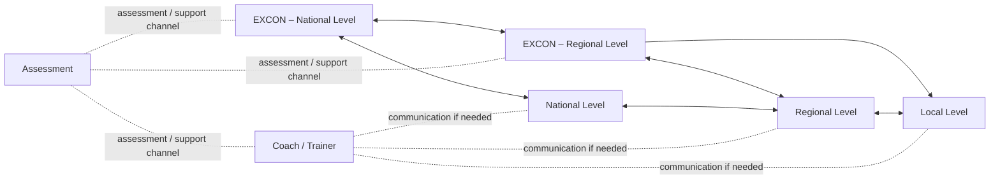
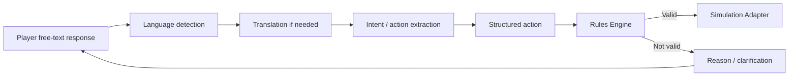
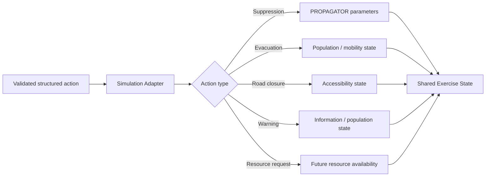
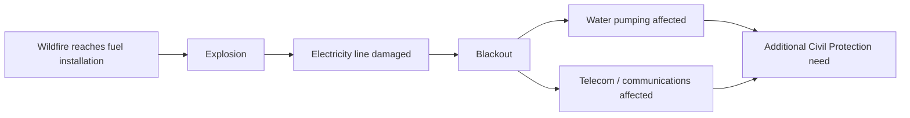
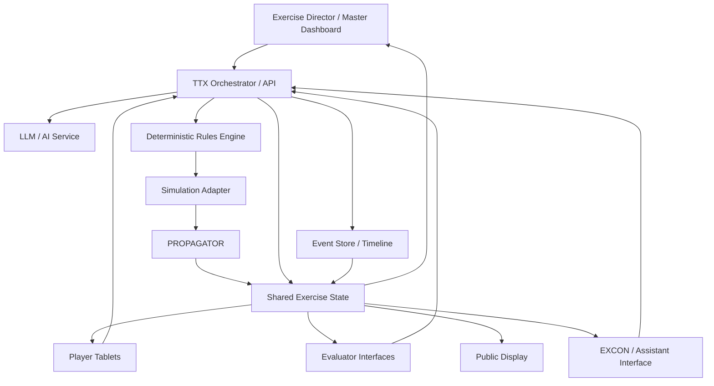
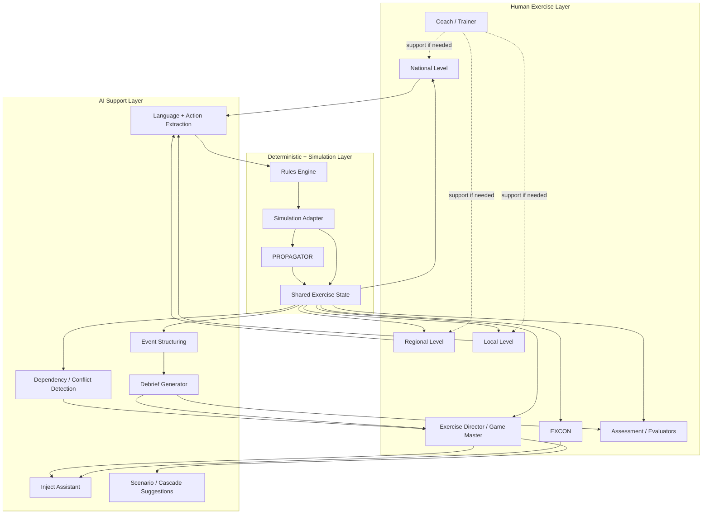

# PPRD East 4 – Agentic AI-supported Table-Top Exercise
## Technical Use Case for Civil Protection Forum 2026

**Working document for CIMA IT – Mirko D’Andrea**  
**Purpose:** translate the existing PPRD East exercise methodology into a practical AI-supported TTX architecture for the Civil Protection Forum prototype, without changing the fundamental exercise logic.

---

# 1. Purpose of the use case

The purpose of the Forum demonstration is to show how **agentic AI workflows can support the preparation, conduct, control, simulation and evaluation of a Civil Protection Table-Top Exercise (TTX)** while keeping human actors fully responsible for operational decisions, exercise control and professional evaluation.

The objective is **not** to create a videogame and **not** to make the AI “play” the emergency on behalf of participants.

The concept is instead to build an **AI-supported exercise-management environment** in which:

- humans make decisions;
- the Exercise Director / Game Master controls the exercise;
- EXCON manages the exercise environment;
- participants communicate and act according to their roles;
- deterministic rules define what actions are operationally possible;
- operational models simulate the physical phenomenon;
- AI interprets, structures, translates, connects and organises information;
- evaluators retain responsibility for assessment;
- the whole exercise is logged and reconstructed for debriefing.

The key principle is therefore:

> **Humans decide. Rules constrain. Models simulate. AI orchestrates and supports. Evaluators evaluate.**

The Forum prototype is a compressed demonstration, but the architecture should be conceived so that it can later support longer TTXs and potentially be extended to CPXs and FSXs.

---

# 2. Reference material and continuity with previous PPRD East TTXs

This use case consolidates and builds on the following material shared for the Forum and from the PPRD East 3 exercise experience:

- `PPRD_East_4_Agentic_TTX_Civil_Protection_Forum_2026.md`;
- historical TTX communication-flow diagram shared in the discussion;
- `Copy of MSEL Final TTX ARM.xlsx`;
- `Copy_of_virtualEXCON Armenia.pdf`;
- `Activity Report_TTX_Armenia.pdf`;
- `Final TTX Armenia Assessment and evaluation report.docx`;
- `Armenia_PPRDE3 Final TTX_assessment_basic report.pdf`;
- `Scenario.pptx`;
- `PPRD CCI Checklist Trainings and Excercises 2022.docx`;
- `What is Bloom.docx`;
- `PPRD East 3 - Final Technical Implementation Report (2020-2024).docx`.

The PPRD East 3 exercise material is particularly useful because it already established several building blocks that should **not be discarded**, but digitised and connected more effectively:

1. use of a **Master Scenario Events List (MSEL)**;
2. injects designed against specific exercise objectives;
3. multiple institutional levels and multiple actors;
4. EXCON as the exercise-control function;
5. coaching/training support separated from player decisions;
6. structured assessment of performance;
7. a virtualEXCON concept already used as an information-management environment supporting **Exercise Control, Coaching and Assessment**;
8. multilingual injects and responses;
9. tracking of inject status and participant answers;
10. testing of real procedures, SOPs, coordination and information management;
11. explicit use of scenario progression over time;
12. exercise assessment linked to learning objectives and constructive alignment;
13. inclusion of cross-cutting issues such as gender, human rights and environment;
14. use of realistic wildfire risk information and PROPAGATOR/MyDewetra-related products;
15. testing of international assistance and UCPM-related decision-making.

The Forum system should therefore be seen as an **evolution of the virtualEXCON/MSEL approach**, not as a completely different exercise methodology.

---

# 3. Existing TTX logic: how the exercise works around the table

The historical TTX diagram shared for this use case represents three different types of relationships:

- **white lines:** how the exercise is played and controlled;
- **blue lines:** normal communication between participants;
- **red lines:** communication used only if needed, mainly for support, coaching or assessment.

The underlying structure can be represented as follows.



This structure is important because the AI-supported prototype should preserve the distinction between:

- **playing the exercise**;
- **communication between players**;
- **exercise-control activity**;
- **training/coaching support**;
- **assessment**.

The AI must not collapse these functions into one autonomous agent.

---

# 4. Human actors and functions

## 4.1 Exercise Director / Game Master

The Exercise Director is the highest exercise-control authority.

The Director must be able to:

- start, pause, resume and reset the exercise;
- select the initial scenario;
- select or configure participating roles;
- create an inject manually;
- edit an existing inject;
- ask the AI to propose one or more injects;
- approve an inject before distribution;
- send an inject to one, several or all roles;
- inspect player responses;
- modify the exercise tempo;
- accelerate or pause simulation time;
- force a scenario change;
- introduce an event that was not generated by participant actions;
- trigger cascading or compounding effects;
- perform a time jump;
- move the exercise to a different phase;
- override a proposed scenario evolution when necessary;
- terminate the exercise;
- open the debrief phase.

**The Exercise Director always remains authoritative.**

The AI can advise the Director, but cannot autonomously take control of exercise progression.

---

## 4.2 EXCON – Exercise Control

EXCON is the operational control function behind the exercise.

Depending on the configuration, it can be divided into:

- National EXCON;
- Regional EXCON;
- additional simulation cells or supporting functions.

EXCON responsibilities include:

- controlling the flow of events;
- sending or simulating communications from entities that are not physically represented at the table;
- maintaining scenario consistency;
- supporting the Exercise Director;
- managing inject timing;
- monitoring player actions;
- introducing new information;
- keeping the physical and digital exercise representations aligned;
- acting as simulated external actors when necessary.

The PPRD East 3 MSEL already used EXCON to simulate actors such as:

- regional emergency-management structures;
- 112 / dispatch functions;
- the ERCC;
- other external organisations not directly represented by players.

The AI-supported system should reduce the amount of repetitive information-management work performed by EXCON, but **must not eliminate EXCON authority or situational awareness**.

---

## 4.3 Players

Players represent real Civil Protection functions or organisations.

The system must allow the Exercise Director to create, remove, rename and reassign roles.

For the Forum prototype, possible roles include:

1. National Civil Protection authority;
2. Regional Civil Protection authority;
3. Local authority / Mayor;
4. Fire and Rescue / firefighting command;
5. school or critical-facility manager;
6. Red Cross / volunteer coordination;
7. other configurable actor according to the scenario.

For a compact Forum configuration, six participants can also operate as **three pairs**.

Players must:

- receive information according to their role;
- interpret the situation;
- communicate with other authorised levels/functions;
- answer injects;
- request information;
- make decisions;
- deploy or request resources;
- issue warnings or evacuation decisions where authorised;
- communicate constraints;
- escalate problems;
- consider external/international assistance when national capacity becomes insufficient.

The software must not hard-code either the number of participants or the number/type of roles.

---

## 4.4 Coach / Trainer

The Coach/Trainer remains outside the direct decision chain.

The function is to:

- facilitate the exercise;
- clarify methodology or rules;
- help participants remain focused on the exercise objectives;
- intervene when the table is blocked or when an explanation is required;
- support learning without solving the scenario for players.

In the AI-supported version, the Coach/Trainer can receive:

- short AI-generated situation summaries;
- indications of unresolved issues;
- a timeline of player decisions;
- potential coaching opportunities;
- exercise-objective reminders.

This information remains advisory.

---

## 4.5 Assessment / Evaluators

Assessment is a separate function from exercise control.

Evaluators observe:

- quality and timing of decisions;
- situational awareness;
- information management;
- inter-agency coordination;
- vertical coordination between local, regional and national levels;
- use of procedures and SOPs;
- warning and early action;
- evacuation planning;
- resource management;
- vulnerable-population considerations;
- international-assistance escalation;
- UCPM interface;
- cross-cutting issues.

This follows the existing PPRD East approach, where TTX assessment was intended to identify good practices and areas for improvement rather than create a simple game score.

The AI can generate **candidate observations**, but the evaluator must be able to:

- confirm them;
- reject them;
- edit them;
- add independent observations.

There is no autonomous AI grading of participants.

---

## 4.6 Observers

Observers can follow the exercise without influencing decisions.

They may have access to:

- public situation view;
- simplified timeline;
- selected scenario information;
- explanation of the AI workflow.

For the Forum, this is useful because many visitors will be watching rather than actively playing.

---

# 5. Core answer to the simulator question

A central design question is:

> **Does the simulator simulate people and interventions, or are those managed only through injects?**

The correct answer is that **injects and simulation are complementary**.

## 5.1 Injects remain central

Injects are still the main mechanism through which the Exercise Director / EXCON introduces information, problems, requests, constraints and events into the TTX.

They are used to:

- drive the exercise;
- test specific capabilities;
- trigger player discussion;
- force coordination;
- create information asymmetry;
- test SOPs and plans;
- trigger escalation;
- introduce external actors;
- move the scenario toward exercise objectives.

The Forum prototype must therefore retain an MSEL/inject-management capability.

---

## 5.2 The simulator must also represent the effects of player decisions

The simulator must not be only a static visual background for predefined injects.

It should receive information generated by participant decisions and represent **the operational consequences of valid actions**.

For example, if a participant decides to:

- send firefighting units to Sector A;
- evacuate a school;
- close a road;
- issue a warning;
- establish an assembly area;
- request additional resources;
- request international assistance;

then the system should represent the consequences of that action in the shared scenario state.

Therefore:

> **yes, the system partially simulates interventions, but only as consequences of player decisions or Master-authorised scenario actions.**

It does not independently invent what the response organisations do.

---

# 6. The simulation should distinguish physical hazard from operational consequences

This separation is essential.

## 6.1 Physical hazard simulation

The wildfire itself should be generated by an operational/physical model such as **PROPAGATOR**.

The LLM must not invent wildfire physics.

The physical model can account for, for example:

- ignition points;
- fuel;
- terrain;
- wind;
- humidity;
- propagation parameters;
- suppression parameters where supported.

The scenario material used in PPRD East 3 already connected risk-assessment logic with:

- hazard;
- exposure;
- vulnerability;
- EWS;
- MyDewetra products;
- PROPAGATOR;
- impact evaluation;
- communication/dissemination;
- preparedness and response capabilities.

The Forum system should preserve this distinction between **modelled hazard** and **exercise-management logic**.

---

## 6.2 Operational consequences

Not every player action changes wildfire propagation.

Examples:

- suppression action → may influence fire behaviour;
- evacuation order → changes population status and mobility;
- warning → changes information available to the simulated population;
- road closure → changes accessibility and traffic;
- allocation of a vehicle → changes resource availability;
- request for external assistance → changes future capacity after mobilisation delay;
- opening a shelter → changes evacuation/support capacity;
- loss of electricity → affects critical infrastructure and possibly communications.

The shared exercise state should therefore contain more than the fire perimeter.

---

# 7. Population simulation: how far should we go?

If by “simulating people” we mean representing the affected population, then the desired answer is:

> **Yes, if this can be done without making the Forum prototype unnecessarily complex.**

For the Forum, population modelling is useful but secondary to the main AI-supported workflow.

## 7.1 Minimum viable population representation

The MVP should represent population in aggregate, for example:

- exposed population by sector;
- people warned / not warned;
- people under evacuation order;
- evacuated population;
- people remaining in affected areas;
- people in schools, hospitals or other critical facilities;
- vulnerable groups where relevant;
- capacity of assembly areas or shelters.

This can be represented digitally and, where useful, physically using LEGO elements.

## 7.2 Optional future sophistication

If technically feasible, later versions could model:

- compliance with warning;
- spontaneous/self-evacuation;
- movement between areas;
- congestion;
- evacuation delays;
- differential behaviour based on age/disability or access constraints;
- information propagation among communities.

For the Forum prototype this should be considered **nice to have**, not a critical dependency.

The system should avoid spending excessive development effort on detailed agent-based population behaviour before the core TTX chain works reliably.

---

# 8. The Master must be able to change time and scenario state

The TTX must not be bound to real-time continuous simulation.

A professional exercise requires the Exercise Director to control the exercise clock.

The system must therefore support:

- pause;
- resume;
- acceleration;
- manual time advance;
- large time jumps;
- potentially moving back to a previous checkpoint for replay or demonstration;
- loading a predefined scenario state.

### Example

The exercise starts at **Day 3** of a wildfire.

Players make decisions and the scenario evolves.

At a certain point, the Master decides:

> “We now jump to Day 10.”

The system loads/calculates the appropriate state, which may include:

- a much larger wildfire perimeter;
- new sectors exposed;
- previously deployed resources unavailable or exhausted;
- critical infrastructure affected;
- displaced population;
- additional logistics needs;
- national capacity under strain;
- increased need for international assistance.

The existing Armenian MSEL already included this kind of exercise logic: one planned inject explicitly introduced a **jump to Day 7** for follow-up disaster-loss-data work. The new system should make this functionality explicit and easy for the Master to control.

---

# 9. Cascading and compounding effects

The system should support scenarios where one impact creates another.

Examples:

```text
Wildfire
   ↓
Fuel station / fuel tank affected
   ↓
Explosion
   ↓
Electricity infrastructure damaged
   ↓
Blackout
   ↓
Communications / water / critical facilities affected
   ↓
Additional operational needs
```

The PPRD East scenario-development material explicitly recognised the value of **complex and cascade events**.

The Armenian exercise MSEL also contained practical examples of compounding conditions, including a fuel-tank explosion associated with interruption of water services and exposed schoolchildren.

## Control principle

Cascading effects should not simply be invented and automatically applied by an LLM.

Preferred workflow:

1. current exercise state is read;
2. AI identifies plausible cascading developments;
3. AI proposes one or more options to the Master;
4. Master chooses:
   - activate;
   - edit;
   - delay;
   - reject;
5. the approved event is applied to the shared scenario state;
6. appropriate injects are generated/distributed.

The AI therefore acts as **scenario-support**, not as autonomous scenario authority.

---

# 10. Scenario design principles

The scenario should be:

- plausible;
- credible;
- sufficiently relevant to Civil Protection;
- operationally meaningful;
- able to test the intended learning objectives;
- able to generate decisions at local, regional and national levels;
- able to escalate from manageable to capacity-stressing conditions.

The PPRD East 3 scenario methodology defined a risk scenario as a way to make hazards tangible through context, causes, events and consequences. It explicitly distinguished a scenario from a forecast and recognised complex/cascading and cross-border events as legitimate scenario types.

For the Forum prototype, the wildfire scenario should therefore combine:

- **hazard evolution**;
- **exposure**;
- **vulnerability**;
- **warning and early action**;
- **response capacity**;
- **critical infrastructure**;
- **population consequences**;
- **resource constraints**;
- **inter-agency coordination**;
- **international-assistance pressure point**.

---

# 11. The central end-to-end exercise workflow

The minimum chain that must work reliably is:

```text
Inject
   ↓
Player receives role-specific information
   ↓
Player decides and communicates in natural language
   ↓
AI interprets and structures the intended action
   ↓
Deterministic rules validate the action
   ↓
Valid action is translated into a simulation command
   ↓
Scenario state changes
   ↓
All authorised interfaces receive the updated state
   ↓
Event is logged
   ↓
Evaluator can observe and comment
   ↓
Master can trigger next inject / phase
   ↓
Debrief reconstructs decision → consequence
```

This is the core MVP.

---

# 12. Player interaction workflow

Players should not have to learn a special command language.

They should be able to respond in natural language and preferably in their own mother tongue.

### Example player response

> “We will evacuate the school towards the municipal sports centre and ask the police to close the northern road.”

The AI converts the statement internally into something similar to:

```text
EVACUATE
  target: School A
  destination: Municipal Sports Centre

REQUEST_RESOURCE
  resource_owner: Police
  purpose: Traffic management

CLOSE_ROAD
  road: Northern access
```

The original statement must always remain stored in the event log.

## Workflow



---

# 13. Deterministic rules layer

This component is essential.

The LLM must **never directly modify the simulation**.

Every proposed action must first pass through a deterministic validation layer.

The rules layer should contain at least:

- authority associated with each role;
- available resources;
- resource status;
- resource location;
- mobilisation times;
- geographical constraints;
- road/access constraints;
- time constraints;
- operational dependencies;
- capacity limits;
- scenario-specific restrictions;
- communication/escalation requirements where relevant.

The rules engine should prevent actions such as:

- deploying resources that do not exist;
- using equipment unavailable to the organisation;
- moving through an inaccessible road;
- instantaneously transporting resources;
- ordering an action outside the role’s authority without required coordination;
- extinguishing a wildfire through an unrealistic free-text statement;
- creating external assistance without the appropriate process.

If an action cannot be executed, the player should receive a realistic operational response, for example:

> Requested firefighting unit unavailable: all ground teams are currently committed.

or:

> Proposed route is inaccessible because the northern access is affected by fire conditions.

The distinction is important:

> **AI understands what the player wants to do. The rules engine decides whether it can be done.**

---

# 14. Simulation Adapter

The Simulation Adapter converts validated actions into parameters understood by the simulation environment.

Depending on the action, it may modify:

- deployment of responders;
- suppression configuration;
- resource availability;
- resource location;
- evacuation state;
- warning state;
- population state;
- road/access state;
- traffic conditions;
- critical-infrastructure status;
- future arrival of requested assets;
- other operational variables.

The adapter is the boundary between the exercise-management system and the physical simulation.



---

# 15. Shared Exercise State

The TTX requires **one authoritative shared state**.

All interfaces should read from the same state:

- Master dashboard;
- EXCON interface;
- player tablets;
- evaluator interface;
- public display;
- simulation engine;
- physical-board support view.

The state may include:

## Hazard

- simulation time;
- fire perimeter;
- active fire sectors;
- weather;
- forecast information;
- secondary events.

## Population

- exposed people;
- warnings issued;
- evacuation status;
- vulnerable groups;
- critical facilities with occupants;
- shelters/assembly areas.

## Resources

- available;
- deployed;
- unavailable;
- requested;
- arriving;
- exhausted/damaged.

## Infrastructure

- roads;
- electricity;
- water;
- telecoms;
- health facilities;
- schools;
- other critical assets.

## Exercise-control state

- current phase;
- active injects;
- inject acknowledgements;
- unanswered injects;
- pending decisions;
- unresolved issues;
- Master overrides;
- time jumps;
- scenario events.

## Assessment state

- evaluator notes;
- candidate AI observations;
- confirmed observations;
- exercise objectives;
- learning objectives;
- CCI-related observations.

---

# 16. AI workflow A – Scenario Orchestration

The Scenario Orchestration workflow reads the current exercise state and supports the Master.

It can provide:

- concise situation summaries;
- unresolved issues;
- conflicting decisions;
- critical dependencies;
- likely emerging consequences;
- possible future developments;
- proposed injects;
- possible cascade events;
- suggestions for moving to the next exercise phase.

Example output to the Master:

```text
Current issue:
The Mayor has ordered evacuation of Sector B.
The Fire Commander is requesting the same road for suppression access.
The school has not yet confirmed transport availability.

Possible next injects:
1. Report congestion on the northern access.
2. Inform the school that one bus is unavailable.
3. Provide updated wind forecast increasing fire spread toward Sector B.
```

The Master selects, modifies or rejects the proposal.

---

# 17. AI workflow B – Inject Management

The inject-management workflow supports the traditional MSEL logic.

The Master can specify an exercise objective such as:

> Test coordination between the municipality, school and emergency services before evacuation routes become compromised.

The AI can propose one or more injects addressed to the appropriate roles.

The lifecycle should be:

```text
Objective
   ↓
AI proposes candidate inject
   ↓
Master edits
   ↓
Master approves
   ↓
Inject sent
   ↓
Receipt/read status tracked
   ↓
Response received
   ↓
Follow-up inject proposed if useful
```

Each inject should have metadata comparable to the existing MSEL, such as:

- Event ID;
- Inject ID;
- exercise day/time;
- sender;
- recipient;
- title;
- description;
- message text;
- translation;
- linked documents;
- status (prepared/sent/unsent/cancelled as required);
- exercise objective;
- evaluation point;
- expected response where relevant.

The existing Armenian MSEL is a strong reference model for this data structure.

---

# 18. AI workflow C – Multilingual interaction

The Armenian TTX already relied on multilingual injects and translated exercise communication.

The Forum prototype should make multilingual interaction intrinsic to the workflow.

The system should perform:

```text
language detection
→ translation if required
→ extraction of intended action
→ structured representation
→ validation
→ response in player's language
```

The translation layer should never alter the original participant input.

For traceability, the event record should retain:

- original text;
- detected language;
- translated text if produced;
- structured interpretation;
- validation result.

---

# 19. AI workflow D – Action Validation support

The AI prepares the action for deterministic checking.

It should extract, where possible:

- actor;
- intended action;
- target;
- location;
- requested resource;
- quantity;
- timing;
- dependency;
- destination;
- conditions;
- intended recipient of communication.

If essential information is missing, the system should ask for clarification rather than guess.

Example:

> Player: “Send two teams there.”

The AI should not invent what “teams” or “there” means if this cannot be reliably resolved from current context.

It should instead request clarification or propose an interpretation for confirmation.

---

# 20. AI workflow E – Time-jump and scenario-change support

The Master should have a dedicated control for:

- `Advance time`;
- `Jump to time/date`;
- `Load checkpoint`;
- `Trigger scenario phase`;
- `Introduce major event`.

For a large time jump, the AI can support preparation by summarising what must change.

Example:

```text
MASTER COMMAND:
Jump from Day 3 to Day 10.

AI SUPPORT:
To create a coherent Day 10 state, consider updating:
- wildfire perimeter;
- burned area;
- road accessibility;
- responder fatigue/resource availability;
- population displacement;
- shelter occupancy;
- power/water interruptions;
- international assistance status;
- outstanding decisions.

Master approves the resulting state before publication to players.
```

Where parameters can be calculated by operational models, model outputs should be preferred over narrative AI generation.

---

# 21. AI workflow F – Cascading/compounding effects

The system should make dependencies visible.

Example:



AI functionality:

- identify plausible dependencies from the current scenario graph;
- alert the Master;
- propose candidate follow-up events;
- estimate which roles should receive new information;
- prepare draft injects.

Master functionality:

- approve/reject the cascade;
- decide timing;
- change severity;
- decide who knows what and when.

---

# 22. AI workflow G – Evaluation and Event Logging

Every significant event should share a common exercise timestamp.

Events include:

- inject created;
- inject approved;
- inject sent;
- inject read/acknowledged;
- player response;
- communication between players;
- extracted action;
- clarification request;
- validation outcome;
- simulation command;
- scenario update;
- EXCON intervention;
- Master override;
- time jump;
- cascading event;
- evaluator observation;
- coaching intervention.

The AI can continuously analyse the event stream and flag potential issues such as:

- delayed decision;
- conflicting decisions;
- missing coordination;
- missing information;
- failed communication;
- resource conflict;
- invalid action;
- unresolved dependency;
- failure to escalate;
- late international-assistance request;
- mismatch between warning and evacuation decision;
- insufficient consideration of vulnerable groups;
- environmental or human-rights issue relevant to the scenario.

These must be treated as **candidate observations**, not final findings.

---

# 23. AI workflow H – Debrief

At the end of the session, the system should automatically reconstruct the main exercise sequence.

Core structure:

```text
Inject
→ information available at that moment
→ player decision
→ structured action
→ validation result
→ operational consequence
→ subsequent scenario change
→ evaluator observation
```

The debrief should support questions such as:

- What information was available when the decision was taken?
- What information was missing?
- Which actors coordinated?
- Which actors did not coordinate?
- What operational constraint affected the decision?
- What changed as a direct result of the decision?
- What would have changed if the action had been taken earlier?
- When did capacity become insufficient?
- When was international assistance first considered?
- Was the need communicated clearly?
- Which information would be required for a UCPM request?
- Were warning and evacuation actions coherent?
- Were vulnerable groups considered?
- Were environmental consequences considered?

The objective is **professional learning**, not a winner/loser score.

---

# 24. Assessment and learning objectives

The TTX should remain linked to explicit learning and assessment objectives.

The PPRD East 3 methodology used constructive alignment: previous knowledge and programme outputs were connected with exercise events/injects so that theory could be applied in practice.

Bloom’s taxonomy was used as a reference to move from simple knowledge toward higher cognitive functions such as:

- understand;
- apply;
- analyse;
- evaluate;
- create.

For the AI-supported TTX this means that the software should not merely count clicks or responses.

It should help evaluators observe whether participants were able to:

- recognise information;
- interpret risk information;
- apply procedures;
- analyse competing needs;
- evaluate available options;
- coordinate and create an operational response.

Assessment should remain linked to exercise objectives and observable behaviour.

---

# 25. Example assessment dimensions

The Armenia TTX assessment material included areas such as:

- ability to apply inter-agency coordination during warning;
- ability to activate early actions based on warning;
- activation of EOC procedures;
- involvement of relevant actors and stakeholders;
- structured communication;
- public information;
- use and communication of evacuation routes;
- availability of safe gathering areas;
- assessment of strategic buildings;
- risk-based planning;
- inter-agency coordination during response;
- needs and vulnerability assessment;
- knowledge of plans/procedures;
- information management;
- international assistance and UCPM-related knowledge;
- ability to participate in international exercises;
- HNS-related capacities.

The Forum evaluator interface can use a simplified version of these dimensions.

---

# 26. Cross-cutting issues (CCI)

The system should allow exercise designers and evaluators to include relevant cross-cutting issues from the PPRD methodology:

- environment;
- gender;
- human rights;
- accessibility;
- disability;
- age;
- vulnerable groups.

Examples of how this can enter the scenario:

- schoolchildren in an exposed area;
- people with reduced mobility requiring evacuation support;
- shelter accessibility;
- disaggregated population information;
- environmental consequences of suppression options;
- protection considerations;
- loss/damage reporting including environmental and population dimensions.

The AI can flag when a scenario condition makes one of these dimensions relevant, but must not mechanically force CCI observations where they are not applicable.

---

# 27. Physical and digital interaction

The physical table remains important.

The exercise should not become six participants simply looking at tablets.

The physical setup should include a large printed operational map.

LEGO or other tangible elements can represent:

- exposed population;
- responders;
- vehicles;
- critical facilities;
- assembly areas;
- blocked roads;
- available routes;
- operational needs;
- other scenario-specific information.

Their shape, number, colour or connection points can encode predefined information.

The physical and digital representations should describe the same state.

### Example

Digital state:

> 120 people exposed in Sector B.

Physical action:

> TTX assistant places the corresponding LEGO population representation in Sector B.

Player decision:

> Evacuate Sector B.

Digital result:

> evacuation status changes, mobility/resource requirements are updated.

Physical result:

> relevant LEGO elements are moved or reconfigured.

The exercise therefore has three simultaneous representations:

```text
Operational model
      ↓
Structured digital exercise state
      ↓
Physical/tangible representation on the table
```

---

# 28. Master dashboard

The Master dashboard should prioritise **situational awareness and control**, not excessive metrics.

Recommended layout:

## Left side – Scenario

- current wildfire perimeter;
- simulation time;
- weather / key forecast parameters;
- exposed population;
- critical infrastructure;
- deployed resources;
- evacuation status;
- roads/accessibility;
- major events.

## Right side – Exercise control

- player roles;
- injects sent;
- inject read/acknowledgement state;
- decisions submitted;
- validation outcome;
- clarification requests;
- unresolved issues;
- resource conflicts;
- coordination dependencies;
- evaluator observations;
- exercise phase;
- event timeline.

## Controls

- start;
- pause;
- reset;
- time acceleration;
- time jump;
- inject creation;
- AI inject suggestion;
- approve/send;
- scenario event insertion;
- cascade-event insertion;
- phase change;
- end exercise;
- generate debrief.

---

# 29. Player interface

Each player should access the exercise through a tablet or browser.

The interface should remain deliberately simple.

The player sees:

- role/function;
- information available to that role;
- current inject;
- relevant situation/map information;
- resources under the player’s control;
- previous decisions/messages;
- communication options allowed by the exercise architecture;
- free-text field for next decision/action.

Optional:

- speech input;
- automatic translation;
- short explanation when an action is rejected by operational rules.

The UI should avoid making the participant interact with technical AI concepts.

From the player’s perspective, it should feel like a normal TTX with a better information interface.

---

# 30. Evaluator interface

Evaluators should be able to follow:

- chronological event stream;
- decisions by role;
- inject-response pairing;
- current scenario;
- validation outcomes;
- key dependencies;
- AI-generated candidate observations;
- existing evaluator observations.

Each manual evaluator observation should be linkable to:

- participant;
- role;
- inject;
- exercise objective;
- simulation time;
- decision/event;
- assessment category.

Suggested categories:

- situational awareness;
- information management;
- command and coordination;
- warning;
- evacuation;
- resource management;
- inter-agency communication;
- vulnerable population considerations;
- CCI;
- escalation/international assistance;
- UCPM interface.

AI-generated candidate observations should be visually distinguishable from evaluator-confirmed observations.

---

# 31. virtualEXCON continuity

The PPRD East 3 `virtualEXCON` was already conceived as an **information-management system supporting Exercise Control, Coaching and Assessment**.

It tracked elements such as:

- inject list;
- participants;
- sent/unsent injects;
- event categories;
- timing;
- answers;
- exercise level;
- compliance with procedures/SOPs;
- inject details.

The Forum prototype can be understood as a next-generation virtualEXCON with additional capabilities:

```text
virtualEXCON / MSEL logic
            +
Natural-language AI interaction
            +
Deterministic rules engine
            +
Live simulation adapter
            +
Shared scenario state
            +
Automated event reconstruction
            +
AI-assisted evaluation/debrief
```

This continuity is useful because it keeps the prototype grounded in an exercise methodology already used by the programme.

---

# 32. Example exercise sequence for the Forum

## Phase 0 – Initial briefing

The Master:

- starts the scenario;
- assigns roles;
- explains communication channels;
- presents the initial operational picture.

The physical map and digital scenario are synchronised.

---

## Phase 1 – Early warning / initial risk information

Example information:

- weather conditions;
- fire-danger forecast;
- initial observations;
- possible ignition reports.

Different roles receive different information.

Possible test points:

- information sharing;
- EWS-to-early-action;
- situational awareness;
- initial coordination.

Players have a short decision window.

Their actions are recorded, validated and, where relevant, applied.

---

## Phase 2 – Wildfire outbreak

Example event:

- multiple fires appear in a forested area;
- field observations / drone information become available;
- weather station information is updated;
- propagation estimates are required.

Possible actions:

- deploy responders;
- request forecast/propagation information;
- warn municipalities;
- prepare evacuation;
- protect critical infrastructure.

PROPAGATOR evolves the wildfire.

---

## Phase 3 – Escalation and competing needs

Example developments:

- smoke affects populated areas;
- schoolchildren are present near an exposed location;
- a road becomes threatened;
- a fuel installation is affected;
- water service is interrupted;
- media/public pressure increases.

This phase can create dependencies such as:

```text
Mayor orders evacuation
        ↓
School requires transport
        ↓
Road capacity becomes critical
        ↓
Fire Service needs same road for access
        ↓
Police / traffic management required
```

The AI should detect this dependency chain and show it to the Master/evaluators without solving it for the participants.

---

## Phase 4 – Capacity exceeded

The scenario deteriorates until available national/local capacities are insufficient.

Possible conditions:

- multiple operational areas;
- exhausted resources;
- competing priorities;
- unavailable routes;
- critical infrastructure failure;
- need for specialised capabilities.

The participants should reach the point where they must consider external/international assistance.

The scenario should not simply display “request UCPM now”.

The pressure should emerge from the operational situation.

---

## Phase 5 – International assistance / UCPM interface

The Master can use an inject simulating ERCC contact or another UCPM-related communication.

The PPRD East 3 Armenian MSEL already included an EXCON-simulated ERCC inject asking for an updated situation report, anticipated needs and information required to facilitate assistance.

The Forum prototype can reproduce this logic.

The player remains responsible for:

- deciding whether support is needed;
- identifying needs;
- communicating the request;
- providing relevant operational information.

AI may help structure the information, but cannot make the decision on behalf of the national authority.

---

## Phase 6 – Optional time jump

Master command:

> Jump to Day 10.

Scenario changes significantly.

The objective is to show that a TTX does not need to simulate every intermediate hour.

The Master can use time compression to move directly to the next decision problem.

---

## Phase 7 – Debrief

The simulation is paused.

The system automatically reconstructs:

- key injects;
- information available;
- decisions;
- validation results;
- operational consequences;
- critical dependencies;
- evaluator observations;
- escalation points.

The evaluator/master then conducts a facilitated discussion.

---

# 33. Detailed role of AI vs non-AI components

| Function | AI | Rules engine | Simulator/model | Master/EXCON | Evaluator |
|---|---|---|---|---|---|
| Understand free text | Yes | No | No | Oversight | No |
| Translate | Yes | No | No | Oversight | No |
| Extract structured action | Yes | No | No | Oversight | No |
| Decide if action is operationally admissible | No | **Yes** | No | Can override exercise logic where appropriate | No |
| Calculate wildfire propagation | No | Constraint input only | **Yes** | Controls scenario | No |
| Change scenario autonomously | No | No | Only on authorised commands | **Yes** | No |
| Propose injects | **Yes** | No | Can provide state | Approves | No |
| Send inject | Workflow support | No | No | **Authorises** | No |
| Propose cascading effects | **Yes** | No | Can calculate effects | **Approves** | No |
| Evaluate participants | Candidate observations only | No | No | No | **Yes** |
| Create debrief timeline | **Yes** | Data source | Data source | Uses output | Uses output |
| Decide UCPM activation/request | No | No | No | Player/Master exercise framework | Assesses process |

---

# 34. Technical architecture

A practical architecture can remain relatively simple.

The logical workflows do not need to be implemented as multiple fully autonomous agents.

A **single orchestration application** can manage the workflows.



Recommended components:

| Component | Function |
|---|---|
| Web application | All user interfaces |
| Backend/API | Exercise state and orchestration |
| LLM service | Translation, interpretation, summarisation, inject assistance |
| Rule engine | Deterministic action validation |
| Simulation Adapter | Converts valid actions into model/state changes |
| PROPAGATOR service | Wildfire physical simulation |
| Database | Scenario, resources, actions, injects, events, evaluation |
| WebSocket/event channel | Real-time synchronisation |
| Master dashboard | Exercise control |
| Player interface | Role interaction |
| Evaluator interface | Observation/evaluation |
| Public display | Demonstration/situation visualisation |

---

# 35. AI guardrails

The workflow must enforce:

```text
Human statement
      ↓
AI interpretation
      ↓
Structured proposed action
      ↓
Deterministic validation
      ↓
Authorised simulation command
```

The AI **may**:

- detect language;
- translate;
- summarise;
- structure information;
- identify dependencies;
- propose injects;
- identify inconsistencies;
- suggest possible scenario developments;
- suggest cascading effects;
- generate candidate evaluator observations;
- prepare debrief material.

The AI **may not independently**:

- approve an operational action;
- create unavailable resources;
- ignore role authority;
- bypass access constraints;
- alter physical laws/models;
- change the scenario without authorisation;
- activate international assistance;
- decide an evaluator conclusion;
- solve the exercise for participants.

---

# 36. Scenario data package

Each scenario should contain a structured package.

## Geography

- operational map;
- road network;
- settlements;
- critical infrastructure;
- safe/assembly areas;
- scenario sectors.

## Hazard

- ignition points;
- fuel information;
- terrain;
- wind;
- humidity;
- wildfire parameters;
- pre-calculated states/checkpoints where useful.

## Exposure / population

- population by sector;
- schools;
- hospitals;
- critical facilities;
- vulnerable groups where relevant;
- evacuation assumptions.

## Resources

- firefighting units;
- vehicles;
- aerial resources if applicable;
- police/traffic-management capacity;
- Red Cross / volunteer capacity;
- local/regional/national assets;
- possible international resources;
- mobilisation times.

## Role permissions

For each role:

- information available;
- communication links;
- decisions permitted;
- controlled resources;
- escalation authority.

## Scenario logic

- initial state;
- exercise phases;
- expected escalation;
- fixed events;
- optional injects;
- cascading-event options;
- time-jump checkpoints;
- international-assistance pressure point.

## Assessment

- exercise objectives;
- learning objectives;
- assessment points;
- CCI dimensions;
- expected observable behaviours.

---

# 37. Hardware and network environment

Minimum configuration:

- 1 dedicated laptop/server running the exercise backend;
- 1 Exercise Director laptop;
- 1 main screen/LED display;
- up to 6 player tablets;
- up to 3 evaluator tablets/laptops;
- 1 optional EXCON/assistant device;
- dedicated local Wi-Fi router;
- internet connectivity for cloud LLM access;
- independent 4G/5G backup if possible;
- charging/power capacity.

Participant interfaces should run in a standard web browser.

No special application installation should be required on tablets.

---

# 38. Connectivity principle

The exercise should **not depend on the Forum public Wi-Fi**.

The core environment should operate on a dedicated local network.

The following should remain locally available:

- exercise state;
- scenario data;
- rules;
- PROPAGATOR;
- inject library;
- event log;
- dashboards.

Internet should mainly be required for the LLM service.

If the LLM connection fails, the system should degrade gracefully.

The Master should still be able to continue with:

- predefined injects;
- deterministic rules;
- simulation;
- manual scenario changes;
- local dashboards;
- event logging.

**Loss of AI must not stop the exercise.**

---

# 39. Forum session format

The Forum concept foresees compressed facilitated sessions.

Indicative structure for a 35-minute session:

| Duration | Phase |
|---:|---|
| 4 min | Introduction and role allocation |
| 3 min | Initial scenario briefing |
| 7 min | Inject / decision cycle 1 |
| 7 min | Inject / decision cycle 2 |
| 7 min | Escalation / UCPM-related decision cycle |
| 7 min | Debrief and AI-supported reconstruction |

The Exercise Director controls the tempo.

The demonstration should favour clarity over realism-by-complexity: visitors must understand the entire information chain within one short session.

---

# 40. Drop-in mode outside facilitated sessions

The stand should remain useful when a full TTX is not running.

A simplified visitor mode can allow a person to:

1. select a role;
2. receive one inject;
3. submit a decision;
4. see the AI interpretation;
5. see whether the action is operationally admissible;
6. see the corresponding scenario consequence.

Target duration: **5–10 minutes**.

The public display can continuously show:

- wildfire evolution;
- current resources;
- anonymised example decisions;
- explanation of the AI workflow;
- physical map relationship.

---

# 41. MVP – what has to work first

The Forum prototype does **not** need to reproduce a complete professional exercise-management platform.

The minimum viable product must demonstrate the full information chain reliably.

## Required MVP

1. one functioning wildfire scenario;
2. Master control interface;
3. configurable player roles;
4. multilingual player input;
5. structured action extraction;
6. deterministic capability/rule checking;
7. simulation adapter;
8. PROPAGATOR integration or equivalent wildfire model connection;
9. synchronised shared scenario state;
10. inject management;
11. event logging;
12. evaluator view;
13. automated session/debrief timeline;
14. physical-map/LEGO interaction concept;
15. reset/replay capability;
16. time jumps controlled by the Master;
17. manual/candidate cascading effects.

The central chain is:

> **Inject → Player decision → AI interpretation → validation → simulation impact → shared situational awareness → evaluation log → debrief.**

---

# 42. Priorities vs nice-to-have functions

## Priority 1 – essential

- master dashboard;
- player roles;
- inject workflow;
- free-text interaction;
- AI action extraction;
- deterministic validation;
- scenario-state update;
- PROPAGATOR connection;
- logging;
- debrief timeline;
- manual Master control;
- time jump.

## Priority 2 – strongly desirable

- multilingual interaction;
- evaluator interface;
- AI candidate observations;
- cascade-event suggestions;
- dependency detection;
- simplified population state;
- physical/digital synchronisation.

## Priority 3 – optional / later sophistication

- advanced agent-based population behaviour;
- highly autonomous scenario generation;
- complex predictive analytics;
- sophisticated automatic assessment scoring;
- fully autonomous multi-agent EXCON simulation;
- very detailed traffic simulation.

The Forum should not fail because Priority 3 features are incomplete.

---

# 43. What the AI should visibly demonstrate at the Forum

A visitor should leave the stand understanding seven things.

## 1. AI can reduce EXCON information-management workload

It can organise inputs, propose injects, translate responses, structure decisions and maintain a coherent event record.

## 2. AI can support participant interaction without replacing participants

Players continue to make their own decisions in natural language.

## 3. Operational models remain authoritative for physical processes

The wildfire comes from PROPAGATOR or another designated physical model, not from an LLM narrative.

## 4. Operational rules remain authoritative for feasibility

Impossible actions are rejected through deterministic constraints.

## 5. The Master remains in control

Time jumps, scenario changes, cascading effects and major transitions remain under human authority.

## 6. Evaluation becomes easier to reconstruct

The system records what information was available, what was decided, when, and what consequence followed.

## 7. The architecture is reusable

The same concept can later be adapted to longer TTXs, different hazards, CPXs and potentially FSXs.

---

# 44. Practical example – complete decision loop

## Situation

A wildfire is approaching Sector B.

The school contains 120 people.

The northern road is still open but is forecast to become exposed.

## Inject to Mayor

> Updated fire information indicates that the fire may reach the eastern part of Sector B within two hours. The primary school is currently operating normally.

## Player response

> “Evacuate the school to the sports centre. Ask police to close the northern road to civilian traffic but keep it accessible to emergency vehicles.”

## AI extraction

```text
ACTION 1
type: EVACUATE
origin: Primary School
Destination: Sports Centre
population: school occupants

ACTION 2
type: ROAD_RESTRICTION
road: Northern Road
civilian_traffic: closed
emergency_traffic: allowed

ACTION 3
type: REQUEST_SUPPORT
organisation: Police
purpose: traffic management
```

## Rules check

Checks:

- Mayor has authority to order evacuation? → yes/no according to scenario rules;
- sports centre capacity sufficient?;
- evacuation route available?;
- buses available?;
- police resources available?;
- road physically accessible?;
- emergency-access exception supported?

## Possible result

```text
EVACUATION ORDER: VALID
BUT EXECUTION CONSTRAINT:
Transport capacity currently covers only 80 people.
Additional transport is required for 40 people.

ROAD RESTRICTION: VALID
Police unit available after 10-minute mobilisation delay.
```

## Consequence

The shared exercise state updates:

- evacuation ordered;
- 80-person transport capacity assigned;
- remaining transport gap = 40;
- road restriction pending in 10 minutes;
- Fire Service retains emergency access.

## AI dependency detection

The system alerts the Master:

> School evacuation has a transport gap of 40 people. This can be used as a follow-up inject or left for players to identify through coordination.

## Master decision

Master decides whether to:

- do nothing and observe whether players identify the gap;
- send an inject to the school;
- send an inject to regional level;
- introduce deteriorating fire conditions;
- accelerate time.

This example illustrates the desired relationship between **human decision, AI interpretation, deterministic rules, simulation and Master control**.

---

# 45. Practical example – cascading effect controlled by the Master

## Current state

- wildfire approaching fuel installation;
- power line located nearby;
- water pumping station depends on grid electricity.

## AI support to Master

> Possible cascading development detected:
> 1. fuel installation affected;
> 2. explosion damages nearby electrical line;
> 3. local blackout;
> 4. pumping station stops;
> 5. reduced water availability for population/firefighting.

## Master options

- Activate full cascade;
- activate only fuel explosion;
- delay event by 30 minutes;
- modify severity;
- reject suggestion.

## If approved

The system:

- updates infrastructure state;
- updates available water/firefighting constraints;
- prepares role-specific injects;
- logs the Master decision;
- updates the public/map state where appropriate.

The important point is that the AI **proposes and organises**; it does not autonomously decide to explode the fuel installation.

---

# 46. Practical example – time jump

## State at Day 3

- fire still partly manageable;
- national assets largely available;
- limited displacement;
- international assistance not yet required.

## Master command

> Jump to Day 10 – major deterioration.

## System response

The system prepares a coherent Day 10 state using modelled/predefined scenario information:

- wildfire perimeter significantly larger;
- several sectors burned;
- one main road unavailable;
- water network partially disrupted;
- shelters partially occupied;
- national firefighting capacity heavily committed;
- resources have fatigue/maintenance constraints;
- additional needs emerging.

## New exercise objective

Players must now assess whether the national system can still cope and whether international assistance should be requested.

This is a normal TTX technique and should be a first-class feature, not a workaround.

---

# 47. Practical example – international assistance / UCPM

The scenario should eventually create operational pressure where national capacity is insufficient.

Possible trigger:

- multiple fires;
- exhausted ground teams;
- aerial capacity unavailable;
- critical infrastructure at risk;
- neighbouring regions also affected.

EXCON/Master may introduce an ERCC communication similar in logic to the PPRD East 3 Armenian TTX:

- ERCC is monitoring the severe situation;
- other countries are also affected;
- national authority is asked to provide an updated situation report;
- anticipated needs should be clearly stated;
- information is required to facilitate assistance and coordination.

The AI can help the participant structure:

- situation summary;
- needs;
- requested capabilities;
- affected areas;
- constraints;
- expected duration.

But:

> **The AI cannot decide that the country requests UCPM assistance.**

The player must decide.

---

# 48. Key implementation decisions for CIMA IT

The following design principles should be treated as non-negotiable.

## 48.1 Player free text must never directly control the simulation

Natural-language input must first become structured data and then pass deterministic validation.

## 48.2 One shared state

Master, EXCON, players, evaluators, model and display must share one authoritative exercise state.

## 48.3 Master authority

The Master must be able to override exercise progression and explicitly control scenario transitions.

## 48.4 Physical model separated from LLM

PROPAGATOR or other physical models calculate the hazard.

The LLM does not replace them.

## 48.5 AI is a support layer

The AI supports:

- information management;
- language;
- interpretation;
- orchestration;
- inject preparation;
- dependency detection;
- logging;
- debrief.

## 48.6 Graceful degradation

If AI is unavailable, the exercise still runs using predefined injects, rules, simulation and manual EXCON controls.

## 48.7 Prioritise reliable MVP over sophistication

The end-to-end chain must work before advanced features are added.

---

# 49. Recommended development sequence

## Stage 1 – Shared state + manual TTX

Implement:

- scenario state;
- roles;
- inject list;
- Master dashboard;
- player interfaces;
- event log.

At this stage the exercise should already be playable manually.

## Stage 2 – AI player-input interpretation

Add:

- multilingual free text;
- action extraction;
- structured representation;
- clarification workflow.

## Stage 3 – Rules engine

Add:

- role authority;
- resource constraints;
- access constraints;
- timing/mobilisation;
- validation feedback.

## Stage 4 – Simulation adapter / PROPAGATOR

Connect valid actions and physical wildfire simulation.

## Stage 5 – Master AI support

Add:

- inject proposals;
- dependency detection;
- cascading-effect suggestions;
- scenario summaries;
- time-jump assistance.

## Stage 6 – Evaluation/debrief

Add:

- candidate observations;
- evaluator confirmation;
- automated timeline;
- debrief view.

## Stage 7 – Optional sophistication

Only after the full chain is stable:

- more detailed population behaviour;
- advanced analytics;
- richer simulation;
- additional autonomous workflows.

---

# 50. Final summary for implementation

The Forum prototype should be conceived as a **next-generation virtualEXCON connected to a live simulation environment**.

It does not replace the traditional TTX methodology.

It preserves:

- EXCON;
- MSEL/injects;
- role-based participation;
- National/Regional/Local coordination;
- Coach/Trainer;
- Assessment;
- exercise objectives;
- scenario progression;
- human control.

It adds:

- natural-language interaction;
- multilingual support;
- AI interpretation;
- deterministic action validation;
- simulation feedback;
- common digital state;
- automated information management;
- AI-supported scenario orchestration;
- event logging;
- debrief reconstruction.

The simplest description of the concept is:

> **The simulator does not play the exercise.**  
> **The players play the exercise.**  
> **The Master controls the exercise.**  
> **The rules engine determines what is operationally possible.**  
> **PROPAGATOR/model simulates the hazard.**  
> **The AI connects all these elements and manages the information workflow.**

For the Forum, the most important thing is to demonstrate this chain clearly and reliably:

```text
INJECT
   ↓
PLAYER DECISION
   ↓
AI INTERPRETATION
   ↓
DETERMINISTIC VALIDATION
   ↓
SIMULATION / OPERATIONAL CONSEQUENCE
   ↓
SHARED SITUATIONAL AWARENESS
   ↓
EVALUATION LOG
   ↓
DEBRIEF
```

Everything beyond this chain should be treated as an enhancement rather than a prerequisite for the demonstration.

---

# Annex A – Compact functional map



---

# Annex B – Responsibility rule

A useful implementation rule for the whole system is:

| Question | Responsible component |
|---|---|
| What did the player mean? | AI |
| Is the action authorised/possible? | Rules Engine |
| What happens physically to the wildfire? | PROPAGATOR / model |
| What scenario development should be introduced? | Master / EXCON |
| What information does each player receive? | Master / EXCON + role rules |
| What consequence follows from a valid operational action? | Simulation Adapter + scenario state |
| What should be assessed? | Evaluator, supported by AI |
| What happened during the exercise? | Event Store + AI reconstruction |

---

# Annex C – Source notes

The use case above incorporates the PPRD East 3 exercise methodology and documentation supplied for this task. In particular:

- the PPRD East 3 Activity Report describes the use of injects to test skills, tools, procedures and plans across multiple stakeholder levels and links exercise design to constructive alignment;
- the PPRD East 3 Armenia assessment documentation frames evaluation as a way to identify performance, good practice and areas for improvement rather than simply assign grades;
- the virtualEXCON material defines virtualEXCON as an information-management system supporting Exercise Control, Coaching and Assessment;
- the scenario material defines scenarios as practical tools representing risk through context, event and consequences, including complex/cascading events, and links wildfire scenarios to PROPAGATOR/MyDewetra-related information;
- the CCI checklist integrates environment, gender and human-rights considerations in exercise planning, delivery and evaluation;
- the Armenian MSEL provides concrete examples of multilingual inject management, EXCON-simulated actors, wildfire escalation, ERCC contact, cascading impacts and exercise time jumps.

