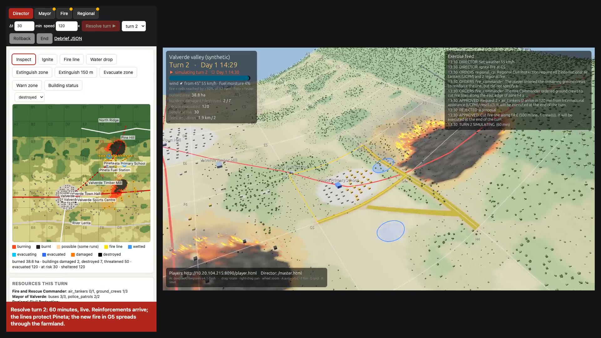
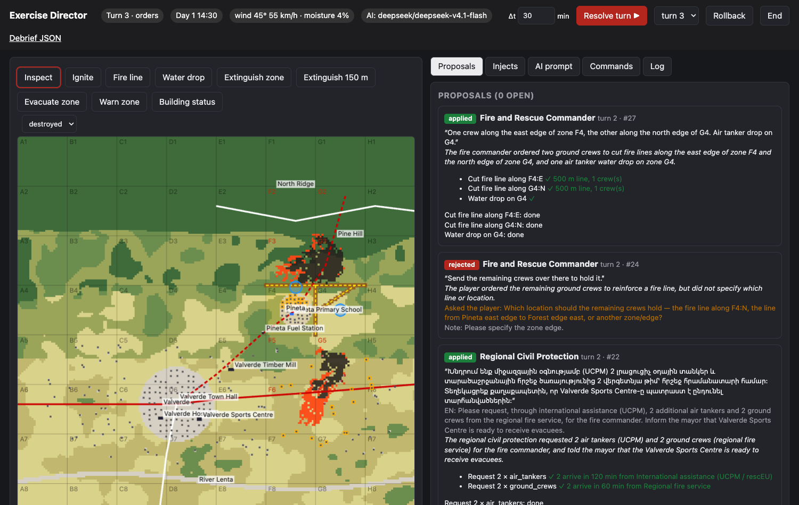
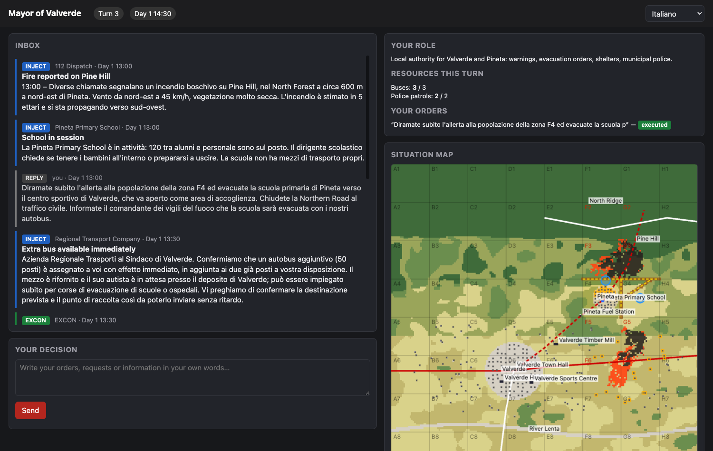
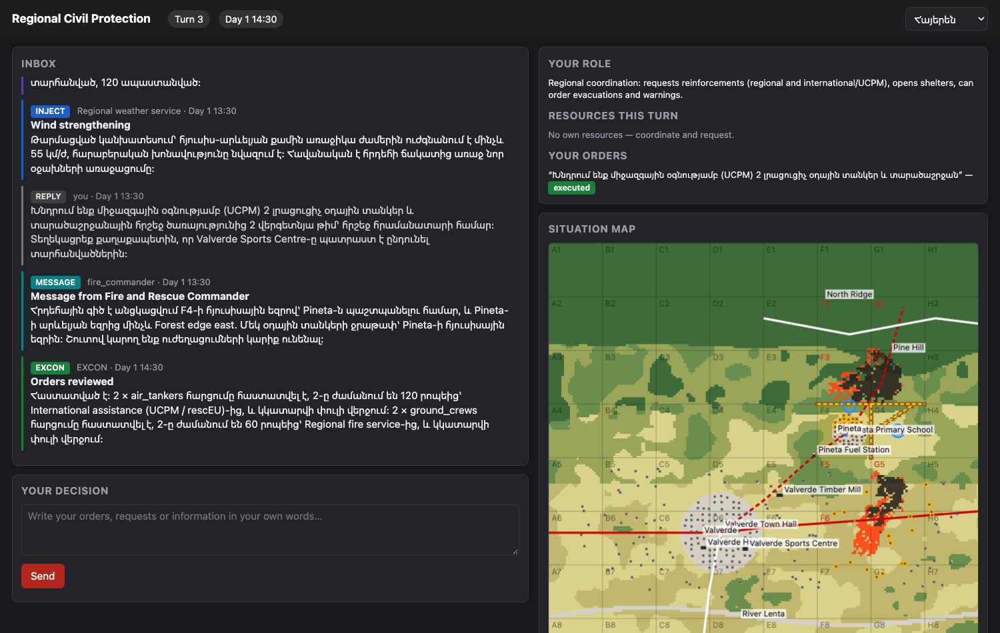
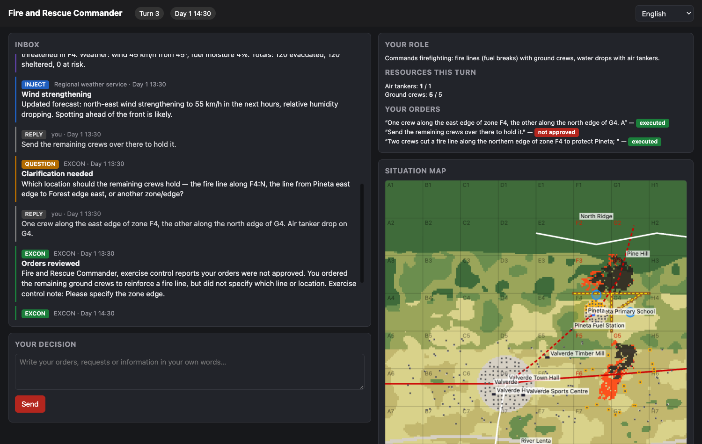
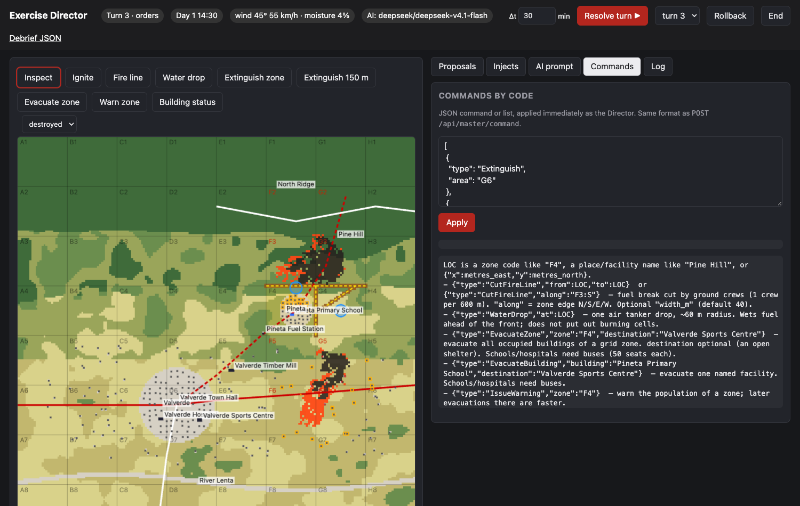
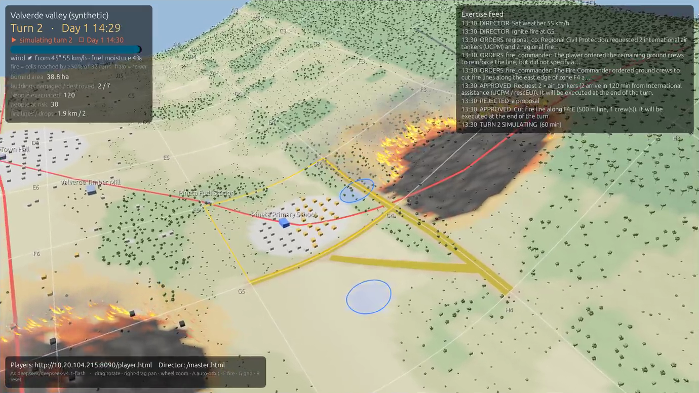
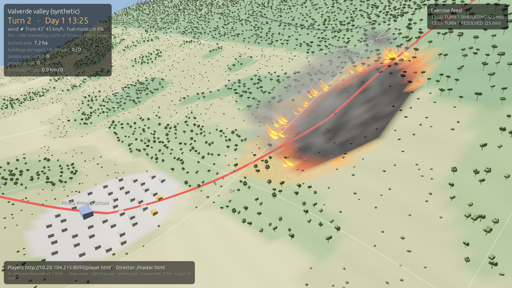

# PPRD East 4 — AI-supported Table-Top Exercise (working draft)

A turn-based wildfire TTX for the Civil Protection Forum 2026:

- a **simulator** (Rust + Bevy): PROPAGATOR-core fire spread as a 32-run Monte Carlo ensemble (the fire is the set of cells reached by at least half of the runs), buildings with occupants, fire lines and water drops, a 3D big-screen view that shows each turn being simulated live, second by second;
- an **Exercise Director (Master)** web console: injects (MSEL), turn control, approval of every player action, god-mode map tools, AI prompts, commands by code, rollback;
- **player** web pages (tablets): role-specific inbox in the player's own language, free-text replies;
- an **LLM** (OpenRouter, `deepseek/deepseek-v4.1-flash`) that translates injects, turns replies into candidate commands, asks for clarification when orders are vague, and writes feedback and situation updates.

> Humans decide. Rules constrain. The model simulates. AI mediates. The Master approves.

Background: [`PPRD_East_4_Agentic_TTX_Use_Case_for_Mirko.md`](PPRD_East_4_Agentic_TTX_Use_Case_for_Mirko.md) (methodology) and [`TTX_Software_Spec.md`](TTX_Software_Spec.md) (target spec, with an as-built section).

## Demo

[](docs/media/ttx_demo.mp4)

**[▶ Watch the demo: docs/media/ttx_demo.mp4](docs/media/ttx_demo.mp4)** (4 min 32 s, 1920×1080, 24 MB, no audio)

A complete two-turn exercise, played for real: every reply was typed into the UI, every translation, interpretation, feedback and situation update was produced live by `deepseek/deepseek-v4.1-flash`, and every consequence was computed by the simulator (32-run Monte Carlo fire, turns simulated live at 120×). Nothing is mocked or pre-scripted except the players' words.

### What you see

| Left: the phone (480 × 1040) | Right: the big screen (Bevy 3D) |
|---|---|
| `play.html`: the Director and the three players as tabs in one window. A yellow dot marks a tab with new messages or open proposals. The red bar at the bottom is the caption explaining each step (added for the video only) | The simulator in slow auto-orbit. Top left: turn, clock, weather, the fire model, key numbers, and a progress bar while a turn is simulated. Top right: the exercise feed (injects, orders, approvals). During each resolution the turn is **simulated live**: flame tongues sized by fireline intensity and by the share of runs that burn each cell, leaning with the wind; a faint glow ahead where only some runs reach; smoke drifting downwind; the ground cooling from glowing to charcoal |

### The situation

The synthetic **Valverde valley** (4 × 4 km, 8 × 8 grid of 500 m zones, see [docs/scenario.md](docs/scenario.md)). **Day 1, 13:00**: a wildfire of about 5 ha burns on the south-west flank of Pine Hill (zone G3), pushed by a 45 km/h north-east wind at 4 % fuel moisture towards the village of **Pineta** (F4). Pineta's primary school holds **120 pupils and staff**. Left alone, the fire reaches Pineta's edge in about an hour.

| Role | Played in | Resources per turn |
|---|---|---|
| Exercise Director (Master) | English | Omnipotent: injects, AI prompts, commands by code, approvals, turn speed |
| Mayor of Valverde | Italian | 2 buses, 2 police patrols |
| Fire and Rescue Commander | English | 3 ground crews (600 m of fire line each), 1 air tanker |
| Regional Civil Protection | Armenian | None: coordinates and requests reinforcements |

### Timeline

| Video | Who | What happens | What it shows |
|---|---|---|---|
| 0:00 | — | The all-roles page opens | One device can run the whole exercise |
| 0:06 | Regional | Switches its language to Armenian | Language is per player and can change at any time |
| 0:09 | Director | *Start exercise*: turn 1, Day 1 13:00; sets the turn speed to 120× | Turn-based control |
| 0:13 | Director | Sends MSEL injects I-01 (fire reported), I-02 (school in session), I-03 (fire behaviour estimate) | MSEL continuity with PPRD East 3. Each inject is translated for its recipients (Italian for the Mayor, Armenian for Regional) |
| 0:51 | Mayor | Reads the injects in Italian | Role-specific information |
| 0:56 | Mayor | Replies in Italian, in free text | No command language to learn |
| 1:03 | Fire | Orders fire lines by zone code and an air-tanker drop | Zone-code addressing (`F4:N`), named places |
| 1:13 | Director | Sees both replies as proposals: original text, English translation, AI summary, commands, and a ✓/✗ verdict per command | AI interprets, rules decide |
| 1:21 | Director | The Mayor's school evacuation is flagged ✗: *"moving 120 people without cars needs 3 buses, only 2 available this turn"* | Deterministic resource checks the AI cannot bypass |
| 1:26 | Director | AI prompt: one extra bus for the Mayor, confirmed by an inject | Master omnipotence in natural language |
| 1:35 | Director | Reviews and approves the AI's proposal: `AdjustResource +1 bus` plus an inject draft from the "Regional transport company" | AI proposes, Master approves; nothing is applied silently |
| 1:40 | Director | Approves the Fire Commander's orders with a note | Master feedback to players |
| 1:44 | Director | Approves the Mayor's orders; feasibility is re-checked, now ✓ with 3 buses | Validation at decision time |
| 1:48 | Director | *Resolve turn* (30 min): the turn is simulated live on the big screen, 30 simulated minutes in 15 s | Approved actions apply at resolution; live simulation |
| 1:51 | — | Flames along the front, the uncertainty glow ahead, fire lines cut, the school evacuating | Intensity and probability drive the flames |
| 2:06 | Fire | Receives an AI-written situation update for its role | Per-role SITREPs in each player's language |
| 2:47 | Director | Turn 2: sends I-04 (wind strengthening), then by code `SetWeather 55 km/h` and `Ignite G5` | Escalation, commands by code |
| 3:07 | Regional | Reads the wind warning in Armenian; requests 2 air tankers (UCPM) and 2 ground crews, in Armenian | International assistance pressure point |
| 3:15 | Fire | Sends a vague order: *"Send the remaining crews over there to hold it."* | — |
| 3:24 | Fire | Receives a clarification question instead of a guess | The AI never invents places |
| 3:29 | Fire | Answers precisely: F4 east edge, G4 north edge, drop on G4 | — |
| 3:34 | Director | Rejects the vague order (with a note), approves the UCPM request and the precise fire lines | Master control over every action |
| 3:52 | Director | *Resolve turn* (60 min), live: the lines hold above Pineta while the new fire in G5 runs through the farmland | — |
| 4:25 | — | Final state; everything is in the debrief log | Traceability |

### What the players wrote and what the AI made of it

<details>
<summary><b>Mayor (Italian)</b>: warn F4, evacuate the school, open a shelter, close the road</summary>

> *Allertate la zona F4 ed evacuate la scuola primaria di Pineta verso il centro sportivo di Valverde, da aprire come area di accoglienza. Chiudete la Northern Road al traffico civile. Avvisate i vigili del fuoco.*

- **AI translation**: "Warn zone F4 and evacuate the Pineta Primary School towards the Valverde Sports Centre, which is to be opened as a reception area. Close the Northern Road to civilian traffic. Notify the fire brigade."
- **Commands**: `IssueWarning F4` ✓ · `EvacuateBuilding Pineta Primary School → Valverde Sports Centre` ✗ *needs 3 buses, only 2 available* · `OpenShelter Valverde Sports Centre` ✓ · `CloseRoad north_road` ✓
- **"Notify the fire brigade"** became a message to the Fire Commander (delivered at once), not a command.
- **Feedback after approval** (Italian): *"Signor Sindaco, le sue disposizioni sono state approvate: avviso alla zona F4; evacuazione della Scuola Primaria Pineta verso il Centro Sportivo Valverde (3 bus per 120 persone); apertura del centro…"*
</details>

<details>
<summary><b>Fire Commander (English)</b>: fire lines by zone code, a drop</summary>

> *Two crews cut a fire line along the northern edge of zone F4; the third crew from Pineta east edge to Forest edge east. Air tanker: one drop on Pineta north edge. Tell regional civil protection we may need reinforcements.*

- **Commands**: `CutFireLine along F4:N` ✓ *500 m, 1 crew* · `CutFireLine Pineta east edge → Forest edge east` ✓ *447 m, 1 crew* · `WaterDrop Pineta north edge` ✓
- **"Tell regional civil protection…"** became a message to Regional, which received it in Armenian.
</details>

<details>
<summary><b>Director (AI prompt)</b>: one extra bus</summary>

> *The regional transport company gives the mayor one extra bus right now. Send the mayor a short inject from the Regional transport company confirming it.*

- **Proposal**: `AdjustResource mayor.buses +1` plus the inject draft *"One additional bus available immediately"*. After approval the bus was added and the inject was translated and sent to the Mayor in Italian.
</details>

<details>
<summary><b>Regional Civil Protection (Armenian)</b>: international assistance</summary>

> *Խնդրում ենք միջազգային օգնությամբ (UCPM) 2 օդային տանկեր և տարածաշրջանային հրշեջ ծառայությունից 2 վերգետնյա թիմ հրշեջ հրամանատարի համար։ Տեղեկացրեք քաղաքապետին, որ Valverde Sports Centre-ը բաց է։*

- **AI translation**: "Please request, with international assistance (UCPM), 2 air tankers, and from the regional fire service 2 ground crews for the fire commander. Inform the mayor that the Valverde Sports Centre is open."
- **Commands**: `RequestReinforcement air_tankers ×2` ✓ *arrive in 120 min from International assistance (UCPM / rescEU)* · `RequestReinforcement ground_crews ×2` ✓ *arrive in 60 min from the Regional fire service*
- **Message**: the Mayor was told, in Italian, that the shelter is open.
</details>

<details>
<summary><b>Fire Commander</b>: a vague order, then a precise one</summary>

> *Send the remaining crews over there to hold it.*

- **No command.** AI summary: *"ordered the remaining ground crews to reinforce the line, but did not specify a location, so no action was recorded and a clarification was requested."*
- **Clarification sent to the player**: *"Where exactly should the remaining ground crews deploy to hold the line — for example along F4:N, F4:E, or another zone edge?"*
- The Director rejected it with the note *"Please specify the zone edge."*

> *One crew along the east edge of zone F4, the other along the north edge of G4. Air tanker drop on G4.*

- **Commands**: `CutFireLine along F4:E` ✓ · `CutFireLine along G4:N` ✓ · `WaterDrop G4` ✓
</details>

### Outcome

| | After turn 1 (13:30) | After turn 2 (14:30) |
|---|---|---|
| Burned area | 7.8 ha | 39.1 ha |
| Fire lines / water drops | 0.95 km / 1 | 1.95 km / 2 |
| People evacuated / sheltered | 120 / 120 | 120 / 120 |
| Buildings threatened | 4 | 51 |
| Buildings damaged / destroyed | 0 / 0 | 2 / 7 |
| People at risk | 0 | 30 |
| Roads cut by fire | Northern Road | Northern Road, SP1 Main Road |
| Reinforcements | — | 2 ground crews arrived (air tankers due 15:30) |

**Debrief reading.** The fire lines on the F4 north and east edges and the G4 north edge held the head of the fire above Pineta. Not a single Pineta building was damaged, and the school was empty 20 minutes after the order. All 9 damaged or destroyed buildings were **farmhouses in G5, G6, F5 and F6**, around the second fire the Director started in turn 2. Nobody warned or evacuated those zones, so their 30 occupants count as *people at risk*. That is exactly the kind of gap a debrief should surface: the log shows when the ignition happened, what each role knew, and that no warning followed. The UCPM air tankers, requested at 13:30 with a 120-minute delay, were still en route when the turn ended. The full event log of this run is in [`docs/media/ttx_demo_log.jsonl`](docs/media/ttx_demo_log.jsonl).

### What the demo demonstrates

| Principle (use case §43) | Where in the video |
|---|---|
| AI reduces EXCON's information-management workload | Translations, proposals, feedback and SITREPs are all generated; the Director only decides |
| AI supports participants without replacing them | Players write freely in their own language; the AI only interprets, and asks when unsure (3:36) |
| Operational models remain authoritative for physics | The fire comes from a 32-run PROPAGATOR ensemble; lines and drops act on its fuel and moisture; flame length is Byram's from the model's intensity |
| Operational rules remain authoritative for feasibility | The bus shortage is caught (1:19) and the AI cannot override it |
| The Master remains in control | Every player action is approved or rejected; the AI prompt becomes a proposal too (1:33) |
| Evaluation becomes easier to reconstruct | The event log (`/api/debrief`) holds every inject, reply, interpretation, decision and consequence |
| The architecture is reusable | Roles, resources, languages and injects all come from the scenario file |

### Run the demo yourself

| Mode | Command | Notes |
|---|---|---|
| **Play it** (any device) | `cargo run --release -p app`, then open `http://<host>:8080/play.html` | Follow the timeline above; the MSEL has the same injects |
| **Play it from a phone** | Add `devtunnel host -p 8080` | See [Playing from a phone](#playing-from-a-phone) |
| **Scripted, API only** | `./scripts/demo_session.sh` against a running `ttx` | The same session through HTTP calls, plus simulator screenshots in `docs/screenshots/` |
| **Scripted and recorded** | `./scripts/record/record.sh` | Re-records `docs/media/ttx_demo.mp4` (plus captions and the run's event log): its own `ttx` on :8090, Playwright plays `play.html`, ffmpeg composes. Details in [scripts/record/README.md](scripts/record/README.md) |

The simulator is deterministic for a given seed, but **the LLM is not**. Wording, summaries and even the split into commands differ from run to run, so the scripted session waits on game state (for example "no proposal still parsing") instead of fixed delays, and approves whatever the model proposed. Timestamped captions for the published video are in [`docs/media/ttx_demo_captions.json`](docs/media/ttx_demo_captions.json).

## Quick start

```bash
# .env in the repo root
OPENROUTER_API_KEY=sk-or-...
# OPENROUTER_MODEL=deepseek/deepseek-v4.1-flash   (default)

cargo run --release -p app            # simulator window + web server on :8080
cargo run --release -p app -- --headless   # web server only (no window)
```

Then open:

| Who | URL |
|---|---|
| **All roles in one window** (Director + every player as tabs; good on a phone) | `http://<host>:8080/play.html` |
| Exercise Director | `http://<host>:8080/master.html` |
| Players (tablets) | `http://<host>:8080/player.html` → choose a role |
| Landing page | `http://<host>:8080/` |

The simulator window shows the join URL with the machine's LAN address. Without an API key the exercise still runs in **manual mode**: injects are sent in English and the Master types the commands for each proposal.

### Playing from a phone

`play.html` puts the Director and every player in tabs of one page (a dot marks new messages or open proposals), laid out for phones. To reach it from outside the LAN, use a [Microsoft dev tunnel](https://aka.ms/devtunnels/docs):

```bash
brew install --cask devtunnel
devtunnel user login -g -d        # GitHub device-code login
devtunnel host -p 8080            # private: only your account can open the URL
# open https://<id>-8080.<region>.devtunnels.ms/play.html on the phone (GitHub login once)
```

Keep the tunnel private (the default). With `--allow-anonymous`, anyone with the URL could run the Director console and spend your OpenRouter credit.

Other options: `--scenario FILE`, `--seed N`, `--port N`, `--web DIR`, `--realizations N` (Monte Carlo runs, default 32), `--cutoff P` (fraction of runs that must reach a cell for it to count as burned, default 0.5; 0.25 gives a pessimistic, planning fire). The synthetic scenario is (re)generated with `cargo run -p scenario --bin gen-scenario`.

## Playing a turn

1. **Director**: *Start exercise*, then send MSEL injects (*Injects* tab) or custom ones. Each player receives them translated.
2. **Players** reply in their own words ("evacuate the school to the sports centre, close the northern road"). The AI turns this into commands, checked against the role's authority and resources.
3. **Director** approves, edits (JSON) or rejects each proposal (*Proposals* tab). Players get feedback in their language. The Director can also act directly: map tools (ignite, fire line, drop, extinguish zone, evacuate/warn zone, building status), *AI prompt* ("the fuel station explodes; tell the mayor"), or *Commands* (JSON).
4. **Resolve turn ▶** (Δt, default 30 min): approved actions are executed, then the turn is **simulated live, one simulated second at a time**. The 3D view redraws continuously, the browsers refresh up to 4 times a second, and when the turn ends every player receives a situation update. **speed** (next to Δt) is simulated seconds per real second: 0 = maximum speed (a 30-minute turn in about 0.45 s), 60× = one simulated minute per second (30 s per turn), 120× = 15 s per turn.
5. Repeat. Use *Rollback* to return to the start of an earlier turn and *End* to finish. *Debrief JSON* gives the full timeline.

Places can be named ("Pineta Primary School", "Pine Hill"), given as **zone codes** from the map grid (`F4`), as zone edges for fire lines (`F4:N`), or as coordinates.

`scripts/demo_session.sh` plays a full two-turn session through the API; `scripts/record/record.sh` plays one in the browser and records the demo video (Italian, English and Armenian players; an AI prompt; a clarification; reinforcements).

## Screenshots

| | |
|---|---|
|  Director: proposals with translation, AI summary and feasibility checks |  Mayor playing in Italian |
|  Regional Civil Protection playing in Armenian |  A vague order gets a clarification question |
|  Commands by code |  Turn 2 simulated live: the lines hold above Pineta, the second fire runs through the farmland |
|  Flames sized by ensemble intensity and probability, tilted by the wind; uncertainty glow ahead, charcoal scar behind | |

## Layout

```
crates/propagator-core  PROPAGATOR fire-spread core (vendored, std-only)
crates/scenario         scenario package + synthetic "Valverde valley" generator
crates/fire             fire model wrapper: ignition, fire lines, drops, extinguish, snapshots
crates/sim              world state, Command catalogue, validation, buildings, resources, digests
crates/llm              OpenRouter gateway + prompt workflows (mockable)
crates/exercise         turn engine: injects, inboxes, proposals, approval, rollback, event log
crates/server           axum HTTP/WebSocket API + LLM orchestration
crates/viz              Bevy big-screen renderer (3D terrain, vegetation, fire, live turn view, HUD)
crates/app              the `ttx` binary
web/                    Master, player, all-roles (play.html) and landing pages (plain HTML/JS, no build step)
scripts/record          scripted + recorded browser session and video composition (Playwright, ffmpeg)
assets/models           Blender vegetation meshes (from propagator_abm)
data/scenarios          generated scenario JSON
docs/                   architecture, API, commands, simulation, LLM, scenario docs; media/ demo video
runs/                   per-run event logs (JSONL) and screenshots (git-ignored)
```

## Tests

```bash
cargo test --release --workspace                 # 104 tests, headless, mock LLM
TTX_LIVE_LLM=1 cargo test -p llm --test live -- --nocapture   # real OpenRouter call
```

The server tests play the whole Master ↔ player ↔ LLM loop over HTTP with a mock model, and also without any model.

## Docs

- [docs/architecture.md](docs/architecture.md): components, threads, data flow, turn loop
- [docs/api.md](docs/api.md): HTTP/WebSocket API (drive everything by code)
- [docs/commands.md](docs/commands.md): the command catalogue and location syntax
- [docs/simulation.md](docs/simulation.md): fire, buildings, evacuation, resources, calibration
- [docs/llm.md](docs/llm.md): LLM workflows, prompts, guardrails, fallback
- [docs/scenario.md](docs/scenario.md): the synthetic scenario, roles, MSEL, how to make another
- [docs/screenshots](docs/screenshots): captures from a live session
- [docs/media/ttx_demo.mp4](docs/media/ttx_demo.mp4): the demo video; [scripts/record/README.md](scripts/record/README.md) explains how it is recorded
