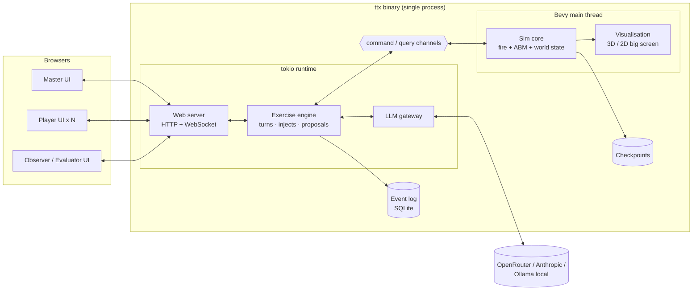
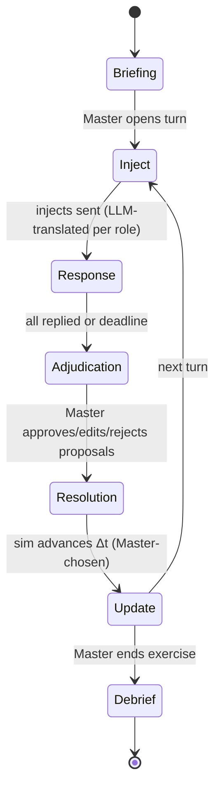

# PPRD East 4 – Agentic TTX: Software Components & Specs

Concise technical spec for the Civil Protection Forum 2026 prototype.
Methodology and rationale: `PPRD_East_4_Agentic_TTX_Use_Case_for_Mirko.md`.
Reference implementation for sim/ABM/rendering: `~/dev/experiments/propagator_abm`.

---

## 1. Decisions

| Topic | Decision |
|---|---|
| Simulator | New Rust + Bevy application. Includes the wildfire model, the ABM, the rich visualisation and the web server |
| Fire model | PROPAGATOR-like cellular model running **in-process**. No external PROPAGATOR service. `propagator-core` (std-only Rust) can be vendored as in the reference repo |
| ABM | Households, people, response units, traffic on the real road network. Same design as the reference `abm` crate |
| Game model | **Turn-based.** Simulation time advances only when the Master resolves a turn or skips time |
| Master | Omnipotent within what the simulator supports. Acts through GUI controls **or** natural-language prompts that the LLM turns into commands |
| Players | Receive injects translated and adapted by the LLM. Reply in free text. The LLM turns replies into actions, limited to that role's resources and permitted actions. **Every player action needs Master approval** |
| Interfaces | Master and players use web browsers (tablets/laptops). The big screen shows the Bevy window |
| AI failure | The exercise continues: Master enters commands through the GUI and sends injects untranslated or pre-translated |

---

## 2. Architecture

One process on the stand machine. The simulation lives on the Bevy main thread; the web server and LLM calls run on a background async runtime; the two sides talk over channels. This is the reference repo's `api.rs` pattern, scaled up.



**Rule:** only the sim core mutates world state, and only by executing `Command`s. The LLM never touches the sim. It only produces candidate `Command`s, and those are validated by the sim and then approved by the Master.

---

## 3. Components (cargo workspace)

Dependency direction is strict, as in the reference repo: model crates are Bevy-free and have fast headless tests. Only `viz` and `app` depend on Bevy.

| Crate | Responsibility | Reuse from `propagator_abm` |
|---|---|---|
| `scenario` | Loads the scenario package (§7): terrain, fuel, OSM, population, facilities, resources, roles, gazetteer, MSEL. World coordinate frame | `scenario` + bake scripts |
| `propagator-core` | Fire-spread kernel, checkpoint | vendored as-is |
| `fire` | Stepping, weather, ignitions, interventions (fuel cut, moisture), exposure/threat, direct perimeter editing | `fire` |
| `abm` | Population (perception → decision → preparation → movement), traffic, havens/shelters, units and tasks, closures, external assets arriving with delay | `abm`, `behavior` (optional) |
| `sim` | The **world state** combining fire + ABM + infrastructure + resources. `Command` catalogue with `validate()` / `apply()`, `advance(dt)`, snapshot/restore, role-filtered **state digests** for the LLM and UIs | new (generalises `game::sim`) |
| `exercise` | Turn state machine, roles and capability manifests, MSEL/injects, inbox, proposals + approval queue, per-role visibility. No Bevy, no HTTP | new |
| `llm` | Provider abstraction (cloud + Ollama), prompt templates, tool/JSON schemas generated from the `Command` catalogue, retries/timeouts, circuit breaker | `chat` provider/config |
| `telemetry` | Append-only event log (SQLite): every inject, message, proposal, decision, command, turn, checkpoint id | `telemetry` |
| `server` | axum HTTP + WebSocket, role-token auth, serves the web UIs, pushes updates | new (replaces `tiny_http` API) |
| `viz` | Bevy rendering: terrain, fire, smoke, buildings, agents, units, overlays. Public-display HUD (turn, clock, latest injects, decision → consequence ticker). Replay of a resolved turn at accelerated speed | `game` renderers |
| `app` | Binary: wires Bevy + tokio + channels. Modes `--headless` (tests/CI, no window) and `--display` | new |
| `web/` | Master, player and observer SPAs (TypeScript). 2D map fed by state tiles/GeoJSON | new |

---

## 4. Command catalogue

All state changes are `Command`s: a single typed Rust enum. The same types generate (a) the LLM tool schemas, (b) the Master GUI forms and (c) the event-log records. **The list will grow** from the methodology docs and future sessions. Initial set:

**Master-only (god mode)**
- Time: `Advance{dt}`, `SkipTo{t}` (fast-forward or state override), `Pause/Resume`, `SaveCheckpoint`, `LoadCheckpoint{id}`, `Reset`
- Fire: `Ignite{area}`, `SetWeather{wind_dir,wind_speed,moisture}`, `SetBurnt{polygon}`, `Extinguish{polygon}`, `SetFuel{polygon,class}`
- Buildings/facilities: `SetBuildingStatus{id|area, occupied|evacuated|damaged|destroyed}`, `SetOccupancy{facility,n}`
- Infrastructure: `SetInfraStatus{asset, ok|degraded|down}` (roads, power, water, telecom), `TriggerCascade{chain}`
- Resources: `AddResource`, `RemoveResource`, `SetResourceStatus{available|committed|unavailable}`
- Population: `SetPopulationState{sector,…}`, `SetBehaviourProfile`
- Exercise: `SetPhase`, `SendInject`, `ForceAction{role, Command}` (acts on a player's behalf)

**Player actions** (a subset; each role's manifest decides which of these it may use)
- `OrderEvacuation{area|facility, destination?}`, `IssueWarning{area, channel}`
- `CloseRoad{segment|area, civilian_only}`, `ReopenRoad`
- `DeployUnit{unit, task: attack|line|drop|standby, target}`
- `OpenShelter{site}`, `RequestResource{from_role|external, kind, qty}`
- `RequestExternalAssistance{capabilities, …}` (arrives after a mobilisation delay)
- `SendMessage{to_role, text}`, `RequestInfo{topic}` (no sim effect; routed through the exercise engine)

Each command has: `validate(&World, actor) -> Ok | Err(reason) | OkWithConstraints(notes)` and `apply(&mut World)`. Validation is deterministic: the unit exists and is free, the target is reachable, capacity is available, the actor has the authority.

---

## 5. Turn loop



| Phase | What happens |
|---|---|
| Inject | Master picks from the MSEL, writes an inject, or prompts the LLM for one. The LLM tailors and translates it for each recipient. Master may preview before sending |
| Response | Players read and reply in free text in their own language, and may message other permitted roles. The LLM parses each reply into a **Proposal**. If a reference is ambiguous ("send two teams there"), the LLM asks the player a clarification question instead of guessing |
| Adjudication | Master sees each proposal: original text, translation, parsed commands, sim validation result, LLM notes. Actions: approve / edit / reject / defer. Player gets feedback in their own language |
| Resolution | Approved commands are applied, then `advance(Δt)` runs. A checkpoint is saved. The big screen replays the turn accelerated |
| Update | Per-role situation update: a digest filtered by visibility, summarised and translated by the LLM. Master gets the full picture plus any flagged issues |

At any phase the Master can issue god-mode commands through the GUI or a prompt. Master prompts produce proposals too: they are shown for one-click confirmation, and nothing is applied silently.

### Proposal record
```
Proposal { id, turn, source: Player(role)|Master, original_text, lang,
           translation, commands: [Command], validation: [Result],
           llm_rationale, status: pending|approved|edited|rejected|deferred,
           master_note, applied_at_t }
```

---

## 6. LLM workflows

| # | Workflow | Input | Output |
|---|---|---|---|
| L1 | Inject adaptation | inject (working language), recipient role, player language | translated role-specific message |
| L2 | Response → actions | reply text, role manifest (allowed commands + controlled resources), role digest, gazetteer | tool calls restricted to the role's commands, or a clarification question |
| L3 | Master prompt → commands | prompt, full digest, full catalogue | tool calls (god mode) |
| L4 | Feedback | proposal decision + validation reasons | message to the player in their language |
| L5 | Situation update | role-filtered digest diff for the turn | short briefing in the player's language |
| L6 *(P2)* | Inject suggestion / cascade ideas | digest, exercise objectives | candidate injects/commands → Master |
| L7 *(P2)* | Debrief narrative | event log | timeline + discussion points |

Grounding: the sim exposes a compact **digest** (clock, fire summary per sector, facilities, units, resources, roads, infrastructure, pending arrivals) and a **gazetteer** mapping names and aliases in every language to entity ids, so "the school" resolves to `facility:school_a`. Tool schemas are generated from the `Command` enum, so the LLM cannot emit a command type that doesn't exist.

Providers: cloud model (primary) and Ollama (local fallback), configured the same way as the reference `chat` crate. All prompts and outputs are written to the event log.

---

## 7. Scenario package

One directory per scenario, baked offline (Python scripts as in the reference repo; nothing runs at game time):

- **Geography:** DEM, fuel raster, render terrain, OSM roads/buildings, sectors
- **Exposure:** synthetic population on buildings, facilities (schools, hospitals, fuel station, shelters) with occupancy
- **Infrastructure graph:** dependencies (fuel depot → power line → pumping station → water) used by `TriggerCascade`
- **Resources:** units and assets per owner role, base location, mobilisation delay, external assets with arrival delay
- **Roles:** `roles.yaml` defining name, level (national/regional/local), language, allowed commands, controlled resources, visibility filter, permitted message links
- **Gazetteer:** multilingual names/aliases → entity ids
- **MSEL:** `msel.xlsx|yaml` using the Armenian MSEL fields (event id, inject id, time, sender, recipient, text, objective, expected response)
- **Initial state + optional checkpoints** (e.g. Day 3, Day 10)

---

## 8. Interfaces

**Master web UI:** 2D map (fire, units, facilities, roads) · clock and turn controls (open turn, deadline, resolve with Δt, skip time, checkpoint/rollback) · inject composer + MSEL list + send · proposal queue (approve/edit/reject) · god-mode panel (forms generated from the catalogue) · prompt box · event timeline.

**Player web UI (tablet):** role card · inbox (injects, messages, feedback) · role-filtered situation + small map · own resources · free-text reply box · message another permitted role. The UI never shows commands or AI terms to players.

**Observer/Evaluator UI (P2):** read-only timeline, inject → reply → decision → consequence chains, evaluator notes.

**Big screen (Bevy):** 3D/2D scene, turn/clock HUD, active injects, accelerated turn replay, anonymised decision → consequence captions.

**Protocol:** REST for actions, WebSocket for pushes (`turn`, `inbox`, `proposal`, `state`). Devices join by QR code / role token. LAN only; internet is used only by the LLM gateway.

---

## 9. Non-functional specs

- **Determinism:** seeded runs; step-size-invariant models (reference repo findings 5, 18); restoring a checkpoint gives the same state.
- **Performance:** resolving 1 h of simulated time should take ≤ 10 s on the stand machine; UI push latency < 1 s; 6 players + 3 evaluators + Master at once.
- **Traceability:** every inject, reply, proposal, decision, command and turn is timestamped (wall clock + sim clock) in the event log, and can be exported for the debrief (JSON/CSV → report).
- **Degradation:** if the LLM is unavailable, all commands can still be entered from the Master GUI and injects can be sent as written. The exercise never blocks on AI.
- **Deployment:** single binary + scenario directory + web assets. Runs on one GPU laptop with a dedicated router, and a 4G backup for the LLM.
- **Configurability:** roles, players, languages and resources come from data, never from code.

---

## 10. MVP scope & build order

1. `sim` over reused `fire`/`abm`: `Command` catalogue v1, `advance`, checkpoints, headless tests
2. `exercise` + `server` + minimal Master/Player UIs: a turn loop you can play manually (no LLM)
3. `llm`: L1 translation, L2 response parsing, L4 feedback; proposal queue in the Master UI
4. L3 Master prompts; god-mode panel generated from the catalogue
5. `viz` big-screen HUD + turn replay; Forum scenario package with MSEL
6. P2: observer/evaluator UI, L5–L7, cascades, debrief export

---

## 11. Open questions

- Forum scenario location (Spotorno, a place in a PPRD East country, or synthetic)?
- Stay on Bevy 0.14 (direct port from the reference repo) or upgrade?
- Working language and player languages for the Forum?
- Default Δt per turn, and how `SkipTo` Day 10 is produced (fast-forward the model vs. Master-painted state vs. pre-baked checkpoint)?
- Do players see a map, or only text plus the shared big screen?
- LLM provider for the Forum (cloud vs. local), given data sensitivity and connectivity?

---

## 12. As built — working draft v0.1 (2026-09-23)

The draft follows this spec with these decisions and deviations. The details are in `README.md` and `docs/`.

| Spec item | Draft |
|---|---|
| Fire model (§1) | PROPAGATOR Rust core vendored in-process (`crates/propagator-core`), legacy 7 fuels, one realization |
| ABM | Not yet. Buildings carry occupant counts; suppression = fire lines and water drops applied directly (no teams) |
| Channels between sim and server (§2) | One `Arc<Mutex<Exercise>>`: the server mutates it, the Bevy renderer `try_lock`s and reads. The lock is never held across LLM calls |
| Crates (§3) | As listed; `telemetry` is a JSONL event log inside `exercise` (`runs/run-*.jsonl`) instead of SQLite |
| Command catalogue (§4) | Implemented, plus zone-grid addressing: `EvacuateZone`, `Extinguish` a zone, fire lines `along` a zone edge. The full catalogue is in `docs/commands.md` |
| Turn loop (§5) | `Briefing → Orders ⟲ resolve(Δt) → Debrief`. Player actions apply at resolution, Master actions immediately. Snapshots per turn with rollback |
| LLM workflows (§6) | L1–L5 implemented (translate, parse reply with clarification and role messages, Master prompt with inject drafts, feedback, situation update). L6/L7 (suggestions, debrief narrative) not yet |
| Scenario package (§7) | One JSON file; synthetic generator; zone grid; multilingual gazetteer; MSEL of 8 injects |
| Interfaces (§8) | Master and player pages in plain HTML/JS with a canvas map; big screen in Bevy with turn replay and HUD. No evaluator UI yet (the debrief JSON covers the log) |
| Degradation (§9) | Works with no LLM: English injects, manual command entry per proposal |
