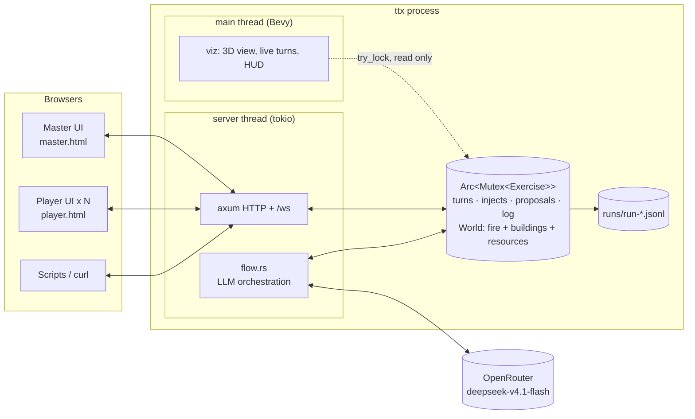
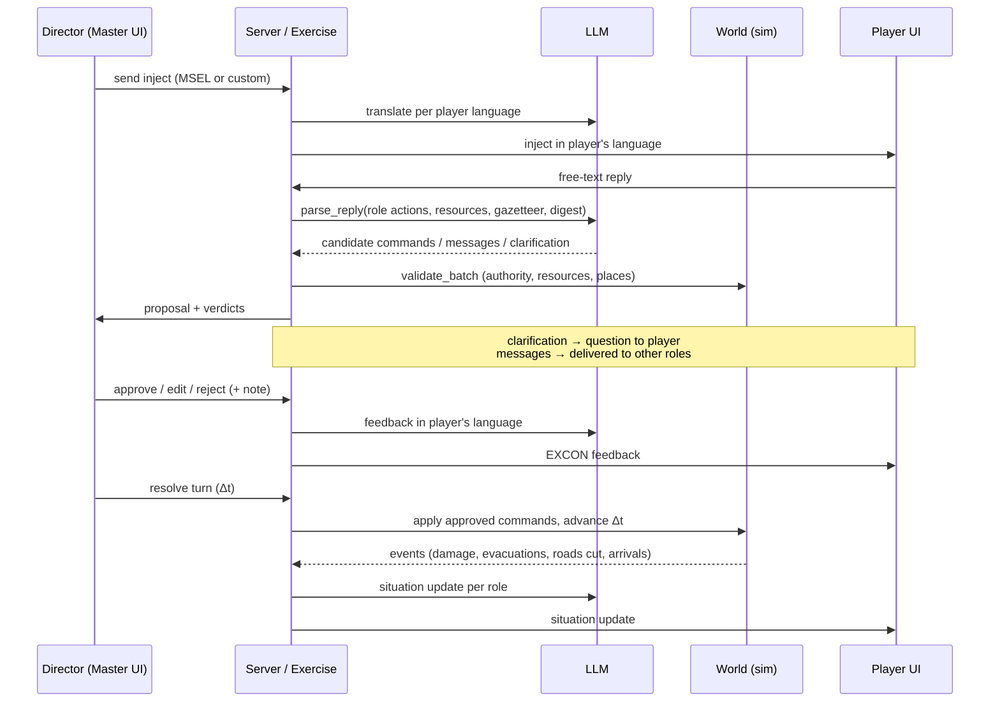

# Architecture (as built, v0.1 draft)

## One process, three kinds of client



- **One shared state**: `Arc<Mutex<Exercise>>`. The server mutates it; the renderer only reads it, with `try_lock` once per frame and only when `generation` has changed. A long operation, such as resolving a turn, never freezes the screen. It just delays the next copy.
- **The lock is never held across an `await`.** LLM workflows copy what the prompt needs, release the lock, call the model, then lock again to store the result (`crates/server/src/flow.rs`).
- **Live updates**: a watcher task polls `generation` every 250 ms and pushes it on `/ws`. Clients re-fetch when it changes (at most 4 Hz, including during live turn simulation), and also poll every 10 s as a fallback. The renderer reads the state directly, every frame.

The target spec (§2) separated the simulation from the server with command channels. The draft uses a shared mutex instead: simpler, and enough for one process with ~10 clients. Only `sim::World` changes the world, and only through `Command`s, so moving to channels later touches just the server and viz glue.

## Crates and dependency direction

```
propagator-core ← fire ← sim ← exercise ← server ← app
      scenario ←──┘       ↑        ↑          ↑
                         llm ──────┘ (server only)
                     viz (reads sim + exercise) ← app
```

Everything below `server` and `viz` is synchronous, has no Bevy or HTTP dependency, and is tested headless in about a second.

| Crate | Role | Key types |
|---|---|---|
| `scenario` | Scenario package + synthetic generator; world frame; zone grid; gazetteer | `Scenario`, `ZoneGrid`, `synthetic::generate` |
| `propagator-core` | Fire-spread kernel (vendored from `propagator_abm`) | `Propagator` |
| `fire` | One-realization fire sim; ignition, fire lines, water drops, extinguish, weather, snapshots | `FireSim`, `CellFire` |
| `sim` | World state; command catalogue; deterministic validation; buildings, roads, resources, reinforcements; digests | `World`, `Command`, `Verdict`, `Actor` |
| `llm` | OpenRouter / mock / off gateway; prompt workflows | `Llm`, `ParsedReply` |
| `exercise` | Turn engine; injects; inboxes; proposals and decisions; rollback; JSONL log | `Exercise`, `Proposal`, `Decision` |
| `server` | HTTP API, WebSocket, LLM orchestration | `router`, `flow::*` |
| `viz` | Bevy renderer | `run` |
| `app` | Binary; `.env`; wiring | `ttx` |

## The information chain



## Turn model

`Briefing → start → Orders → Resolving (minute by minute) → Orders … → end → Debrief`.

- Player actions approved during a turn are **applied together at resolution**. The turn is then **simulated live**: the phase becomes `resolving`, and a server task (`flow::run_resolution`) calls `Exercise::step_resolution(60 s)` until Δt (default 30 min) has elapsed. It takes the lock once per simulated minute and waits `pace_ms` between steps (0 = maximum speed; one step costs about 0.1 ms). Every step bumps `generation`, so the renderer redraws each minute and the WebSocket feed (throttled to 4 Hz) makes browsers re-fetch at a coarser rate. `finish_resolution` then logs the turn, snapshots it and opens the next one. Player replies, rollback and End are refused while a turn is resolving. Director commands and injects still work.
- Master actions (map tools, commands by code, approved AI prompts) **apply immediately**.
- Resources are per turn: usage resets when a turn opens. Approved but not yet applied actions already hold resources, so a second drop by the only air tanker is rejected.
- A snapshot is taken at the start of every turn. **Rollback** restores the world and marks later proposals as `rolled_back`; messages stay as history.
- `AdvanceTime` skips time outside the turn loop (time jumps).

## Guardrails, as implemented

| Rule (use-case §35) | Where |
|---|---|
| Free text never touches the simulation | `llm` only returns JSON; `exercise::attach_parse` deserialises into `Command`s; unknown shapes go into `invalid` |
| AI understands, rules decide | `World::validate_batch`: role authority, resource pools (including already-approved actions), place resolution, capacities |
| No guessing | Prompt rule plus the `clarification` path; unknown places are rejected (`unknown place "…"`) |
| Master authority | Every player proposal needs approval; Master prompts are proposals too |
| Graceful degradation | `Llm::off()`: English injects, `parse_failed` leaves the proposal for manual entry; tested in `server/tests/http_flow.rs::works_without_llm` |
| Traceability | Every inject, message, proposal, decision, command and turn is in the log with wall clock, sim clock and turn |

## Instrumentation

| Hook | Purpose |
|---|---|
| `P` key / `runs/shot.req` | One screenshot of the simulator window (`viz::screenshot`) |
| `runs/rec/ON` flag file | While it exists, a frame every 100 ms to `runs/rec/<unix-ms>.png` (`viz::record`); used by `scripts/record` to make the demo video |
| `TTX_ORBIT=1` | Start the camera in slow auto-orbit (presentations, recordings) |
| `runs/run-*.jsonl` | Full event log of every run |

The demo video ([`docs/media/ttx_demo.mp4`](media/ttx_demo.mp4)) is produced by [`scripts/record`](../scripts/record/README.md): Playwright plays every role in `play.html` while the simulator saves timestamped frames, and `compose.py` puts the two side by side, in sync.
