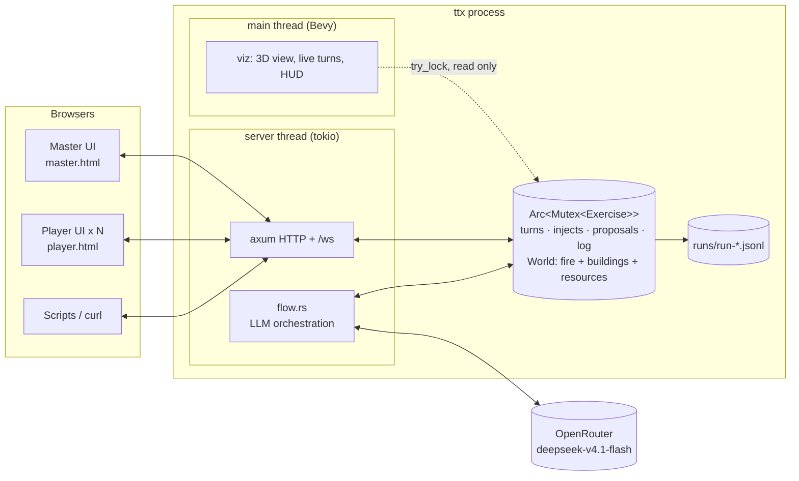
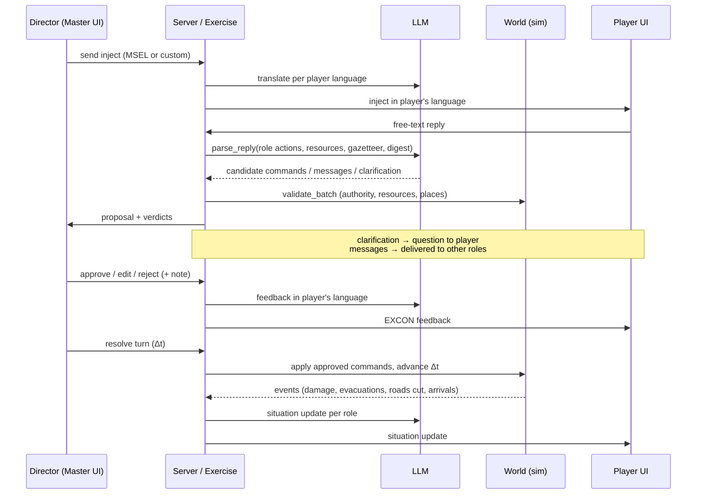

# Architecture (as built, v0.1 draft)

## One process, three kinds of client



- **One shared state**: `Arc<Mutex<Exercise>>`. The server mutates it; the renderer only reads it, with `try_lock` once per frame and only when `generation` has changed. A long operation, such as resolving a turn, never freezes the screen. It just delays the next copy.
- **The lock is never held across an `await`.** LLM workflows copy what the prompt needs, release the lock, call the model, then lock again to store the result (`crates/server/src/flow.rs`).
- **Live updates**: a watcher task polls `generation` every 250 ms and pushes it on `/ws`. Clients re-fetch when it changes (at most 4 Hz, including during live turn simulation), and also poll every 10 s as a fallback. The renderer reads the state directly, every frame.

The target spec (§2) separated the simulation from the server with command channels. The draft uses a shared mutex instead: simpler, and enough for one process with ~10 clients. Only `sim::World` changes the world, and only through `Command`s, so moving to channels later touches just the server and viz glue.

## Crates and dependency direction

```
propagator-core ← fire ← sim ← exercise ← server ← app
      scenario ←──┘       ↑        ↑          ↑
                         llm ──────┘ (server only)
                     viz (reads sim + exercise) ← app
```

Everything below `server` and `viz` is synchronous, has no Bevy or HTTP dependency, and is tested headless in about a second.

| Crate | Role | Key types |
|---|---|---|
| `scenario` | Scenario package + synthetic generator; world frame; zone grid; gazetteer | `Scenario`, `ZoneGrid`, `synthetic::generate` |
| `propagator-core` | Fire-spread kernel (vendored from `propagator_abm`) | `Propagator` |
| `fire` | One-realization fire sim; ignition, fire lines, water drops, extinguish, weather, snapshots | `FireSim`, `CellFire` |
| `sim` | World state; command catalogue; deterministic validation; buildings, roads, resources, reinforcements; digests | `World`, `Command`, `Verdict`, `Actor` |
| `llm` | OpenRouter / mock / off gateway; prompt workflows | `Llm`, `ParsedReply` |
| `exercise` | Turn engine; injects; inboxes; proposals and decisions; rollback; JSONL log | `Exercise`, `Proposal`, `Decision` |
| `server` | HTTP API, WebSocket, LLM orchestration | `router`, `flow::*` |
| `viz` | Bevy renderer | `run` |
| `app` | Binary; `.env`; wiring | `ttx` |

## The information chain



## Turn model

`Briefing → start → Orders → Resolving (second by second) → Orders … → end → Debrief`.

- Player actions approved during a turn are **applied together at resolution**. The turn is then **simulated live**: the phase becomes `resolving`, and a server task (`flow::run_resolution`) calls `Exercise::step_resolution(1 s)` until Δt (default 30 min) has elapsed. It takes the lock once per simulated second and keeps the simulation clock at `speed` simulated seconds per real second (0 = as fast as possible, ~0.45 s for a 30-minute turn). Every step bumps `generation`, so the renderer redraws continuously and the WebSocket feed (throttled to 4 Hz) makes browsers re-fetch at a coarser rate. `finish_resolution` then logs the turn, snapshots it and opens the next one. Player replies, rollback and End are refused while a turn is resolving. Director commands and injects still work.
- Master actions (map tools, commands by code, approved AI prompts) **apply immediately**.
- Resources are per turn: usage resets when a turn opens. Approved but not yet applied actions already hold resources, so a second drop by the only air tanker is rejected.
- A snapshot is taken at the start of every turn. **Rollback** restores the world and marks later proposals as `rolled_back`; messages stay as history.
- `AdvanceTime` skips time outside the turn loop (time jumps).

## Guardrails, as implemented

| Rule (use-case §35) | Where |
|---|---|
| Free text never touches the simulation | `llm` only returns JSON; `exercise::attach_parse` deserialises into `Command`s; unknown shapes go into `invalid` |
| AI understands, rules decide | `World::validate_batch`: role authority, resource pools (including already-approved actions), place resolution, capacities |
| No guessing | Prompt rule plus the `clarification` path; unknown places are rejected (`unknown place "…"`) |
| Master authority | Every player proposal needs approval; Master prompts are proposals too |
| Graceful degradation | `Llm::off()`: English injects, `parse_failed` leaves the proposal for manual entry; tested in `server/tests/http_flow.rs::works_without_llm` |
| Traceability | Every inject, message, proposal, decision, command and turn is in the log with wall clock, sim clock and turn |

## Rendering the fire (`crates/viz`)

| Layer | Driven by |
|---|---|
| **Flame tongues** (`flames.rs`, `shaders/flame.wgsl`) | Byram flame length `L = 0.0775·I^0.46` of the ensemble-mean fireline intensity, × 9 visual exaggeration (real flames here are 3–5 m). Height and tongue count also scale with the fraction of runs that burned the cell, and flames only stand in the first 7 min after the (quantile) arrival time. Tongues lean downwind by the Froude tilt `atan(U/√(gL))`, drawn at 50 %, max 35°. The shader domain-warps a procedural tongue texture for roiling edges and flicker |
| **Uncertainty halo** | Cells reached by some runs but fewer than the cutoff: short, dim, redder tongues whose brightness follows the probability, plus a faint orange tint on the ground |
| **Ground** (`terrain.rs`) | Burning cells cool with age: flame-front orange → glowing ember bed → dark red → charcoal. The scar is mottled charcoal/ash per cell |
| **Smoke and sparks** | A plume emitted at a steady rate matched to the particle budget, from the flaming band (weighted by intensity) and smouldering ground. Puffs rise buoyantly, cool and slow, and are carried downwind by a wind that increases with height and gusts, so the column bends over and trails away; they grow and thin from dense brown-grey to pale blue-grey. Camera-facing billboards, no shadows |
| **Vegetation** | Blender pines, oaks and bushes from `propagator_abm`, charred as cells burn |

Geometry is rebuilt every frame from the latest snapshot, so the fire stays alive between simulation updates and at any speed. `TTX_CAM="x,y,distance,yaw,pitch"` sets the starting view.

## Instrumentation

| Hook | Purpose |
|---|---|
| `P` key / `runs/shot.req` | One screenshot of the simulator window (`viz::screenshot`) |
| `runs/rec/ON` flag file | While it exists, the window is piped into ffmpeg at 20 fps and encoded while recording (`runs/rec/sim.mkv`, wall-clock timestamps; `viz::record`); used by `scripts/record` |
| `TTX_CINEMATIC=1` (or `TTX_ORBIT=1`, key `A`) | Cinematic camera director (below) |
| `TTX_CAM="x,y,distance,yaw,pitch"` | Starting view |
| `TTX_LLM_CASSETTE=<file>` (+ `TTX_LLM_CASSETTE_MODE=auto\|replay\|record`) | Record/replay LLM answers (`llm::cassette`), for reproducible, fast recordings |
| `runs/run-*.jsonl` | Full event log of every run |

The demo video ([`docs/media/ttx_demo.mp4`](media/ttx_demo.mp4)) is produced by [`scripts/record`](../scripts/record/README.md): Gemini TTS narration, Playwright playing every role in `play.html`, the simulator streamed into ffmpeg, and one compose pass with subtitles.

## Camera and lighting (`crates/viz/src/camera.rs`)

- **Director.** `sync` turns new log entries into camera cues (`Snapshot::cues`): an inject naming a facility, place or zone; a parsed proposal; an approved proposal; a Director command. Each cue becomes a shot of that location sized to what it covers (a fire line, a zone, a building), with a slow push-in, held for 5–6 s. While a turn is simulated the camera follows the burning front (smoothed centroid, distance growing with the fire's extent, slow orbit). Otherwise it holds a wide establishing orbit. All parameters are eased; the camera rises if terrain would block the view; manual input takes over for 15 s.
- **Smoothing.** Focus, distance and pitch follow their targets through critically damped springs (continuous velocity, no overshoot). The fire target is the whole fire area (burning and burnt), which grows steadily. Terrain clearance raises the pitch through a slow boost with hysteresis, so there is no oscillation.
- **Lighting.** A low (~20°), warm late-afternoon sun with cascaded shadows, weak sky-tinted ambient light for contrast, distance fog with sun scattering, ACES tone mapping, HDR + bloom (the additive flames glow), and 8 flickering point lights (up to 6·10⁸ lm) on the hottest 200 m bins of the fire, bright enough to light the ground in daylight. Smoke, flames and sparks cast no shadows.
