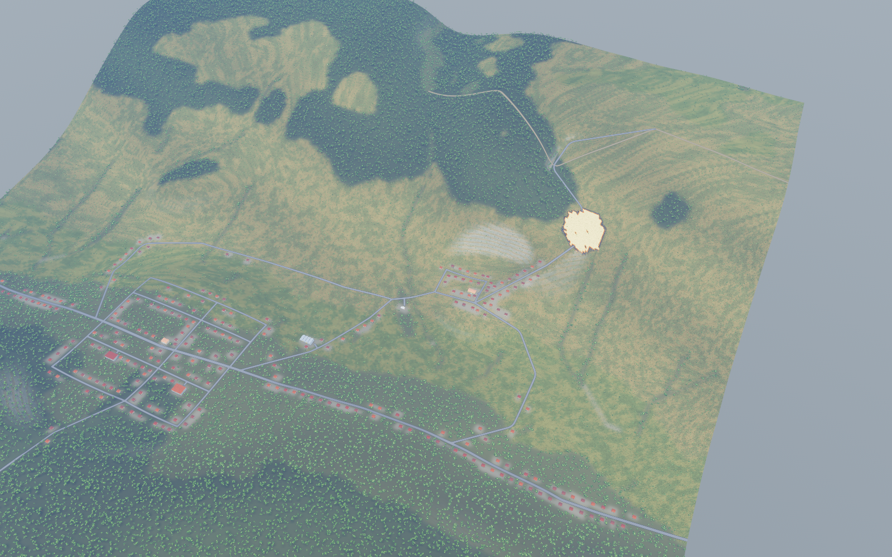

# Paesaggio Valverde — valle dei Castagni

L'avvio ordinario carica `data/scenarios/valverde_factory.json`. Il territorio
sintetico misura 4 × 4 km: valle asimmetrica, valloni laterali, versanti boscati,
prati e coltivi, insediamenti lungo una rete stradale con percorsi alternativi.
Quote 70–473 m; 266 edifici e 1.085 occupanti; 22 strade comprese le sei vie
d'accesso alle strutture nominate. Ruoli, risorse, nomi delle strutture e MSEL
provengono dal TTX storico. Le case sono riposizionate lungo la rete senza
sovrapporre gli ingombri; il settore operativo segue la nuova posizione.

```sh
# Richiede Python 3 e NumPy. Stesso seed e template producono gli stessi byte.
python3 scripts/scenario_factory.py landscape
# Variante separata, senza modificare il territorio di avvio:
python3 scripts/scenario_factory.py landscape --seed 22 --output runs/valverde-22.json
cargo run --release -p app -- --scenario runs/valverde-22.json
# Esercitazione storica e demo calibrata:
cargo run --release -p app -- --scenario data/scenarios/synthetic_valley.json
```

`cargo run -p scenario --bin gen-scenario` continua a generare il template storico.
La nuova ricetta usa quel template come ingresso; non dipende dal checkout di
`propagator_abm` e rifiuta di sovrascrivere il template. Un manifest accanto al
JSON registra seed, parametri, traduzione dei combustibili, statistiche e hash
del template e del risultato. Un seed alternativo può essere rifiutato se non
soddisfa i controlli di fattibilità: non viene corretto silenziosamente.

Il DEM fisico rimane a 20 m; la superficie visuale a 5 m è una semplice
interpolazione bilineare, senza ostacoli o dettaglio fisico aggiuntivo. La
vegetazione deriva da quota, esposizione, pendenza e drenaggio, con traduzione
esplicita dai tipi EU12 alle classi storiche TTX. Il manifest conserva la tabella.
L'intera impronta degli edifici viene liberata dal combustibile. Le strade non
vengono trasformate implicitamente in tagliafuoco.

La rete è disegnata esplicitamente in `scripts/factory/network.py`: SP1 di
fondovalle, salita al crinale, uscita sud, due accessi distinti a Pineta e vie
locali nei due abitati. Le curve extraurbane hanno raccordi quadratici contenuti;
le vie locali mantengono intersezioni regolari. Non si cercano separatamente
percorsi ottimi tra ogni coppia di punti, evitando zig-zag, inversioni ai punti
intermedi e fasci di strade convergenti.

Il generatore adatta il DEM sintetico a 20 m ai tracciati: un problema vincolato
di sterro/riporto limita la pendenza, distribuendo le correzioni sulle banchine
con regolarizzazione spaziale. Non è una correzione nascosta del renderer: il
DEM risultante è quello fisico salvato. Il manifest registra correzione massima,
RMS e residuo numerico (nel territorio fornito: circa 57 m massimi, 4,73 m RMS).
Sono movimenti di terreno sintetici, non lavori dimensionati su dati reali.

Raccordi e incroci condividono realmente i vertici; i percorsi sono verificati
sul grafo Rust usato dalla simulazione. Il controllo finale rifiuta pendenze
carrabili bilineari superiori al 18%; il risultato fornito arriva al 15,77%.
È una soglia della ricetta, non un criterio progettuale validato per mezzi reali.

## Tool trasferiti e provenienza

I kernel `grid.py`, `terrain.py`, `vegetation.py` erano già presenti nel TTX.
Questo aggiornamento estrae inoltre da `propagator_abm/tools/factory/strade.py`
ricerca dei percorsi, ricampionamento e saldatura degli incroci, e da `borghi.py`
geometria degli ingombri e separazione dei poligoni. Sono in `scripts/factory/roads.py`
e `layout.py`, senza percorsi assoluti al pacchetto del gioco o scritture al sorgente.
La rete esplicita, i raccordi, la preparazione del terreno e la ricetta
`valverde.py` sono adattamenti TTX. La ricerca sul DEM trasferita resta un tool
di pianificazione, separato dal disegno della rete fornita.

Progetto sorgente: `~/dev/experiments/propagator_abm`, revisione
`48acd1c4d660468d67f5e5e05de731ad3a5ac309`; SHA-256 dei file effettivamente
letti in `scripts/factory/provenance.json`. Codice trasferito sotto EUPL-1.2,
come l'integrazione Factory esistente. I tool del gioco per punteggi, politiche
autonome, ritocco della costa e forzatura del combustibile al valico non sono
necessari alla ricetta del TTX e non vengono eseguiti.

## Verifica

```sh
cargo test --release --workspace --offline
scripts/lab/run.sh scripts/lab/landscape.json runs/landscape-lab-new
python3 scripts/snapshot.py --scenario data/scenarios/valverde_factory.json \
  --out runs/landscape-review-new \
  --spec 'name=valley,t=0,at=home,dist=3800,yaw=25,pitch=50,ui=0,marks=0;name=overhead,t=0,at=home,dist=4600,pitch=89;name=fire,t=30,at=fire,dist=1700,yaw=35,pitch=45,ui=0,marks=0'
```

I test del territorio verificano accessibilità di tutte le strutture nominate
e delle tre uscite, conservazione degli occupanti e assenza di sovrapposizioni
tra gli edifici, assenza di inversioni del tracciato e rispetto degli ingombri
delle strutture pubbliche. La suite di laboratorio confronta scenario storico e nuovo
con semi 1, 2, 3 e comandi reali, includendo un riferimento senza interventi.
Le catture usano l'harness invisibile, senza HTTP o LLM.

Cambiare territorio cambia i tempi dell'incendio: gli inject conservati sono
un punto di partenza per il facilitatore, non una dichiarazione che la taratura
storica o il video dimostrativo valgano per il nuovo scenario.

Verifica del 2026-10-21: rigenerazione identica byte per byte, 24 corse accoppiate
sui semi 1–3 senza comandi rifiutati; cinque catture GPU invisibili ispezionate
(panoramica, abitato, crinale, zenitale con UI, incendio a 30 minuti). Output in
`runs/valverde-final/` e `runs/valverde-final-lab/`.


