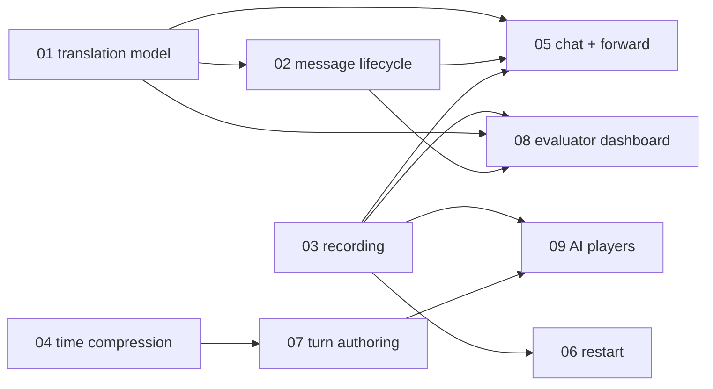

# Specs for v0.3 (pilot session and after)

Nine additions and changes requested after the v0.2 draft (`TTX_Software_Spec.md` §12). One file per item. Each states the goal, what exists today, requirements, design (data, API, UI), tests, dependencies and open questions. Design docs in `docs/` describe what is built; these describe what is planned, and move into the main docs when implemented.

Status: **draft for discussion**, 2026-09-24. Priorities are proposed, not yet agreed.

## Index and proposed priority

The next milestone is a **pilot session**, and **player chat with inject forwarding** is its must-have feature.

| Wave | Spec | Item | Effort | Depends on |
|---|---|---|---|---|
| 1 | [01](01-translation-model.md) | Dedicated translation model (benchmarked: `google/gemini-3.1-flash-lite`) | S | – |
| 1 | [02](02-message-lifecycle.md) | Asynchronous sending: visible translation step | S/M | 01 |
| 1 | [03](03-session-recording.md) | Complete session recording, including conversation logs | S/M | – |
| 2 | [05](05-player-chat-forward.md) | 1-to-1 player chat with auto-translation; forwarding injects | M/L | 01, 02, 03 |
| 2 | [06](06-session-restart.md) | Restart and resume a session | M | 03 |
| 2 | [04](04-time-compression.md) | Time compression per turn, time jumps | S | – |
| 3 | [07](07-turn-authoring.md) | EXCON pre-authors turns; editor and generation | L | 04 |
| 4 | [08](08-evaluator-dashboard.md) | Live evaluator dashboard in the evaluator's language | L | 01, 02, 03 |
| 4 | [09](09-ai-players.md) | AI players; AI assessment of the exercise | L | 03, 07 |

Reasoning: Wave 1 is small and everything else builds on it. Chat needs translation (01) and visible send states (02), and the recording (03) has to exist before the first pilot, because a pilot exists to produce data. Restart (06) is in Wave 2 so a crash does not end a pilot. The pilot can run with the game file hand-edited (the current MSEL) until 07 exists. If evaluators attend the pilot, they can use a read-only view of the exported log until 08 is ready.

## Cross-cutting rules (apply to every spec)

- Only `sim::World::apply` changes the world, and only with a `Command`. New features add messages, log events and UI, not new ways to touch the sim.
- Never hold the exercise mutex across `.await`. Anything slow (translation, LLM) is a background task that re-locks to store its result.
- Model code stays free of Bevy and HTTP and is tested headless with a mock LLM (`Llm::mock`) and the cassette.
- Every new event is written to the log (spec 03) with wall clock and simulated clock.
- The exercise never blocks on AI: each new AI step has a fallback (see the "Failure" row of each spec).

## Assumptions to confirm

- Item 3 of the request ("player basati su AI con valutazione dell'excon (compreso contesto)") is read as **two** things: AI players, and an AI assessment of how the exercise is going, with its context. Both are in spec 09.
- "Evaluators" are a new read-only role type with its own language, not EXCON or players.
- Chat is free of EXCON approval, because it has no simulation effect. Orders still have to go through the reply box and the approval queue (spec 05).
